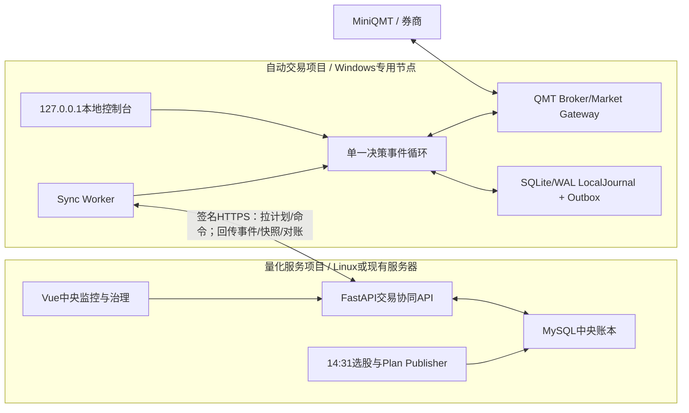
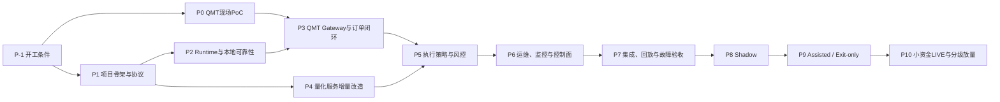

# 尾盘量化自动交易系统开发计划与推进记录

> 文档版本：V1.71
> 建立日期：2026-08-13  
> 当前阶段：当前源码版本为`0.1.0.dev56`，单一尾盘策略已接入`QMT_TRADING`；dev54桌面预览属于历史发行物。真实交易仍须完成程序化交易权限、小额真实报撤单、交易时段与异常场景验收
> 设计基线：《尾盘量化自动交易系统总体与详细设计方案_v3.1》  
> 适用项目：`auto-trading-system`、`ai-stock-assistant`

## 0. 当前有效方案与修订推进入口（2026-10-22）

2026-10-22状态校准：当前源码能力以`README.md`顶部“2026-10-21 个人尾盘实盘版”和`pyproject.toml`版本为准。下列2026-10-19记录是当时的只读接入与dev54发行里程碑，不再代表当前源码装配状态；其现场证据仍保留。源码具备`QMT_TRADING`路径不等于实盘准入已完成，最终权限仍以人工批准的小额真实报撤单验收为门槛。

2026-10-19真实数值映射：新增QMT只读资金/持仓到`AccountFact`/`PositionFact`的严格映射，委托与成交保留真实数量但尚未关联内部订单。现场第四独立session通过：一个股票账户、一条原有持仓、当日委托/成交均为零；账户事实的`coherent`固定为false，原有持仓不自动归属策略。相同资金号跨账户类型的状态查询已修正为股票类型限定。首次复用旧session基数连接失败的报告保留，改用新基数后全链路通过；正式主进程与EXE仍为MOCK。详见[现场实施记录](docs/design/v3.1/QMT真实只读接入实施记录_20261019.md)和`evidence/r31/20261019-qmt-facts/`。

本文件继续作为唯一主计划入口。当前技术和实施要求采用V3.1：现有量化系统负责计划与全部业务历史，Windows定时拉取和每日回传，盘中内存运行，SQLite保留最小关键恢复记录。量化端使用现有MySQL的auto_trade_表组。

2026-10-19真实只读接入：用户已安装中金QMT并开通极简权限，切换后出现XtMiniQmt进程及通信队列。项目独立SDK环境完成真实连接；用户完成股票实盘账户校验后，主动状态、资产/持仓/委托/成交及CLOSED行情全部通过。新增自动发现/状态交叉核验/指纹选择、账户锁、有界自有Job、三个稳定session、行情独立检查及不可变脱敏结果。下一项为交易时段与异常场景验证、真实Gateway及主流程接线。详情见[现场实施记录](docs/design/v3.1/QMT真实只读接入实施记录_20261019.md)，正式主进程仍MOCK，dev54 EXE及量化后台保持原样。

2026-10-19新增交付：dev54 Windows免安装单文件EXE，内含Python及本机页面，桌面启动器编排现有监护、引擎、同步代理及操作台，退出只回收自有Windows Job。默认新建独立MOCK/零额度/只读预览会话，不连接量化生产服务；真实QMT及正式交易准入保持待办。EXE使用说明见[说明文档](docs/Windows_EXE使用说明_20261019.md)，验证记录见`evidence/r31/20261019-exe`。本轮只编辑自动交易项目，量化后台、生产数据库、注册任务和旧包保留。

2026-10-15代码复核：源码修正现场台额度显示、账单视图范围校验、页面旧响应/分页隔离及后端成交范围复核，完成页面与非页面全部设计能力的逐项现状清单，见[代码复核与完整功能清单](docs/design/v3.1/代码复核与完整功能清单_20261015.md)。Windows全量2381项、量化173项通过；发行包仍为dev53，本次源码修订未发布。旧Windows十路由为兼容布局/占位，不计为完整页面；V2每日页面已实现部分能力，全部设计功能尚未完成。当前报备方向为量化多头并可能叠加底仓日内回转，正式规则待确认。D1退出汇总、页面接线、账单结算和录放等缺项按报告单列，不能全部归因于QMT环境。

- 详细设计：docs/design/v3.1/详细设计方案.md；项目根目录V3.1_Python基线修订Word副本（Windows基线3.11）。
- 当前开发看板与22个修订工作包：docs/design/v3.1/开发修订计划与推进记录.md。
- 当前业务前提：用户明确策略尚未确定；既有买入/退出规则属于模拟开发基线。正式策略、仓位和交易参数确认后再冻结版本并接入宿主。通用运行功能继续开发。
- 本轮内容：用户授权连续完成的[F1—F4收口计划](docs/design/v3.1/首版离线交付收口计划.md)已完成，交付dev53。正常进程模拟交易、量化日记录页面、SAMPLE账单基础对账及发行贯通见[操作说明与验收结果](docs/design/v3.1/首版离线交付与操作说明_20260926.md)。此前版本、备份能力和证据保留。
- 下一阶段：优先离线补齐D1退出汇总契约与查询，再按功能清单补现场台和V2业务页面；正式策略规则、目标QMT采证/适配、券商账单、候选激活及Tick录放分别按依赖验收。
- 验证：Windows全量2381项，覆盖率91.19%；独立安装V3.1专项877项；量化auto_trading169项，含已安装Windows包、真实本机TLS、隔离MySQL和业务查询/样例对账贯通；页面实际交互及模块专项类型检查通过。前端全库6项既有类型错误单列，其他业务文件保留。
- 剩余状态：首版模拟工程DONE，实盘发布NOT_READY。D1独立退出汇总如实为业务INCOMPLETE，正式财务核验为PROVISIONAL。默认MOCK/0额度、显式PAPER测试额度分开；生产数据库/凭据/已注册任务和真实QMT保持原状态。

以下第1节起完整保留V1.49历史方案和推进证据，作为旧阶段记录。历史段落中的技术路线、当前看板、下一项和完成状态均属于当时基线；与V3.1不一致时以本节链接的新方案和R31看板为准。旧DONE须经R31-001映射与新版验收后才能计入新版完成。

历史最近阶段：GOV-001环境诊断、QMT-001/002/003只读探针和QMT-004离线审批预检完成；P0现场结论、QMT-004实盘时序及P3/P5等待目标QMT机器和业务准入，CI-001等待本项目远端仓库。

## 1. 文档用途（以下为V1.49历史记录）

本文件是项目后续推进的唯一主计划和持续记录入口，用于维护：

- 开发阶段、依赖关系和实施顺序；
- 每个工作包的负责人、状态、完成标准和验收证据；
- 当前迭代、下一步工作和阻塞事项；
- 重要技术决策、风险变化和范围调整；
- 每次开发、测试、现场验证和上线推进记录。

代码实现、接口契约、测试报告和现场证据仍保存在各自项目中，本文件只保存索引、状态和结论。

## 2. 状态与更新规则

### 2.1 状态定义

| 状态 | 标记 | 含义 |
|---|---|---|
| 待开始 | `TODO` | 已进入计划，但前置条件未满足或尚未排期 |
| 可开始 | `READY` | 前置条件已满足，可以立即实施 |
| 进行中 | `IN_PROGRESS` | 正在开发或验证；同一负责人不应同时开启过多工作项 |
| 待验收 | `VERIFYING` | 实现完成，正在执行测试、评审或现场验收 |
| 已完成 | `DONE` | 完成标准满足，证据已记录，无遗留必做事项 |
| 已阻塞 | `BLOCKED` | 因权限、环境、业务决定或外部资源无法推进 |
| 已取消 | `DROPPED` | 经记录决策后退出当前范围 |

### 2.2 每次推进后的记录要求

每完成一次实际工作，必须同步更新以下内容：

1. 更新“当前推进看板”和对应工作包状态；
2. 填写实际完成内容、测试结果和遗留问题；
3. 添加代码、接口、测试报告、截图或现场记录的相对路径；
4. 在“推进日志”增加一条记录；
5. 若改变架构、安全边界或协议语义，增加ADR/决策记录；
6. 只有完成标准全部满足，才能把状态改为`DONE`。

## 3. 技术路线

### 3.1 总体技术选择

本项目采用“两个独立项目、一个中心服务、一个Windows交易节点、接口驱动、模块化单体优先”的技术路线：

| 决策维度 | 首期选择 | 选择原因 |
|---|---|---|
| 项目边界 | `ai-stock-assistant`与`auto-trading-system`两个独立项目 | 隔离Linux业务服务与Windows/QMT环境，允许独立发布和回滚 |
| 架构形态 | 两个模块化单体 | 每个项目内部按领域模块组织，跨项目通过版本化API协作 |
| 中心职责 | 计划生成、计划发布、中央账本、监控、命令和治理 | FastAPI、APScheduler和MySQL共同实现中央控制面 |
| Windows职责 | QMT连接、行情、订单、策略执行、硬风控、本地恢复和对账 | 贴近券商事实，在中心断网时仍能安全管理已有订单 |
| 通信方式 | Windows主动访问HTTPS/JSON REST + HMAC-SHA256 | 计划/命令轮询与事件/快照/对账回传使用统一协议 |
| 一致性方式 | 不可变TradePlan + LocalJournal/Outbox + 中央幂等投影 + 券商对账 | 网络和回调不能保证恰好一次，以至少一次传输和业务幂等收敛 |
| 本地数据库 | LocalJournal端口 + SQLite/WAL单Writer | 保存计划缓存、事件、订单映射、成交去重、Outbox和本地控制证据 |
| 行情存储 | 60秒内存窗口 + SQLite订单证据 + Parquet/ZSTD Recorder | 完整Tick按交易日/股票分区写本地SSD并保留20个交易日 |
| 开发顺序 | 协议/Mock优先，QMT PoC并行，最后接真实Gateway | 先验证状态机和异常恢复，再接入真实资金接口 |

首期跨项目协作统一使用HTTPS REST，项目内部采用进程内事件、MySQL事务、SQLite事务和Durable Outbox完成一致性闭环。

### 3.2 运行拓扑与数据流



完整业务数据流：

1. `ai-stock-assistant`在14:31完成正式选股，独立Plan Publisher读取已持久化结果并生成不可变TradePlan；
2. Windows长期运行的Sync Worker从14:30开始主动轮询计划，验签后原子写入LocalJournal；
3. Runtime完成QMT、账户、资产、持仓、活动委托、行情和存储预检后，从`READY_PAUSED`受控进入`AUTO`；
4. 策略生成OrderIntent，必须先提交LocalJournal事务，再由Broker Gateway异步报单；
5. QMT回调只复制字段并进入有界队列，单一事件循环更新订单状态；
6. 订单、成交、风险和控制事件与Outbox同事务保存，Sync Worker分批回传中心；
7. 中央API先保存原始事件，再幂等投影为委托、成交、资产和持仓视图；
8. 启动、重连、盘中周期和15:10任务主动查询QMT，以券商事实完成对账；
9. 中心不可用时不加载新计划，已冻结计划按本地规则运行，事件保留在Outbox等待补传。

### 3.3 量化服务项目技术栈

量化服务直接在现有`ai-stock-assistant`中增量实现：

| 层 | 采用技术 | 实施方式 |
|---|---|---|
| Python | Python 3.12 | 与现有服务统一构建和部署 |
| API | FastAPI 0.127 + Uvicorn 0.40 | 新增独立`/api/v1/trading`路由和节点HMAC鉴权 |
| Schema | Pydantic 2.12 | TradePlan、事件、快照、命令和错误信封生成JSON Schema |
| 数据库 | 现有MySQL + PyMySQL 1.1 | `auto_trade_*`表承载计划、原始事件、投影、命令和对账 |
| 调度 | 现有独立APScheduler 3.11 Worker | Plan Publisher、投影修复、15:10检查和数据保留 |
| 中央页面 | 现有Vue 3 + TypeScript + Naive UI + ECharts | 增加计划、节点、订单、持仓差异、同步和Incident页面 |
| 测试 | 现有pytest体系 + 契约测试 | API、MySQL幂等、重复/乱序投影和签名向量进入CI |

量化服务增量模块按`api → service → database/repository`组织。Plan Publisher读取已完成并真实持久化的正式选股运行，不能嵌入选股事务，也不能让计划发布失败回滚正式选股。

### 3.4 Windows自动交易项目技术栈

| 层 | 首期采用技术 | 实施方式 |
|---|---|---|
| 语言/运行时 | Python 3.11 x64 | P0登记券商QMT和随附XtQuant的具体版本与安装包hash，形成发布三元组 |
| 项目管理 | `pyproject.toml` + 锁定依赖 + 离线wheelhouse | XtQuant使用券商QMT随附SDK，版本写入发布清单 |
| QMT交易 | `XtQuantTrader` | 每账户一个长期实例，异步报撤单，主动重连和重新订阅 |
| QMT行情 | `xtdata.subscribe_quote/get_full_tick` | 只订阅候选、持仓和必要指数，约15只股票 |
| 核心并发 | `asyncio`单一决策事件循环 + 有界队列 | Runtime、订单和退出状态只有事件循环可以修改 |
| 回调接入 | QMT回调线程 → 线程安全入队 | 回调内禁止HTTP、SQLite、同步查询和策略计算 |
| 本地写入 | 专用Persistence Writer + SQLite/WAL | 只有一个Writer；OrderIntent提交成功后才允许调用QMT |
| 中心同步 | HTTPX异步客户端 + Durable Outbox | 计划/命令拉取、事件批传、快照和对账均由Windows主动发起 |
| 内部调度 | APScheduler `AsyncIOScheduler` + `asyncio`单调时钟循环 | 交易时点/15:10用Scheduler；心跳、Outbox和盘中轮询用单调时钟；不得启动第二Trader |
| 完整Tick | Runtime Recorder Worker + Parquet/ZSTD | 按trade_date/symbol分区写本地SSD，保留20个交易日 |
| 本地操作台 | Vue 3 + TypeScript + Naive UI + ECharts；FastAPI/Uvicorn监听`127.0.0.1` | Microsoft Edge应用模式桌面快捷方式打开 |
| 测试 | pytest、pytest-asyncio、Mock Gateway、Replay、故障注入 | CI覆盖订单、风险、幂等、恢复和协议逻辑 |
| 打包 | Python 3.11 x64虚拟环境 + 锁定wheel + 配置Schema + 回滚包 | 盘后维护窗口安装，次交易日盘前核验 |

### 3.5 进程与线程模型

Windows节点采用一个交易核心进程和一个独立监护进程：

| 运行单元 | 形式 | 主要职责 | 状态修改权限 |
|---|---|---|---|
| `trade-runtime` | 唯一核心进程 | QMT会话、事件循环、策略、风控、订单、同步和本地API | 唯一实时状态所有者 |
| QMT callback | SDK回调线程 | 复制/规范化字段并入有界队列 | 发布BrokerEvent/MarketEvent |
| Persistence Writer | Runtime内专用线程/Worker | SQLite/WAL短事务、Checkpoint和健康状态 | 返回commit结果和存储健康事件 |
| Sync Worker | Runtime内异步任务 | 签名HTTP、计划/命令轮询和Outbox上传 | 发布计划、命令和同步结果事件 |
| Recorder Worker | Runtime内专用Worker | 完整Tick写Parquet/ZSTD和20日保留 | 消费独立有界行情副本队列 |
| `watchdog` | 独立小进程 | 存活、心跳、磁盘、连续崩溃和外部HALT | 受控拉起Runtime并写外部HALT标记 |
| Operator Console | Runtime内回环API | 查看、二次确认、急停、人工接管和诊断 | 通过控制事件请求变更 |

trade-runtime内部承载Sync Worker、Persistence Writer和Recorder Worker；Windows任务计划程序负责启动trade-runtime与watchdog，业务时点由Runtime内部Scheduler执行。

### 3.6 Windows本地操作台技术路线

Windows端建设独立本地操作台，承担交易现场运行与安全处置。量化服务断网期间，本地操作员仍可查看QMT和订单真实状态，执行暂停、接管、急停、对账和证据导出。

#### 3.6.1 技术实现

| 项目 | 首期方案 | 约束 |
|---|---|---|
| 前端 | Vue 3 + TypeScript + Vite + Naive UI + ECharts | 与量化服务前端技术保持一致，可复用团队经验和视觉规范，但代码保存在本项目 |
| 本地后端 | trade-runtime内嵌FastAPI | Application/Control Service提供查询和受控命令API |
| 访问地址 | `http://127.0.0.1:<local_port>` | Microsoft Edge应用模式桌面快捷方式打开 |
| 状态更新 | 1秒HTTP轮询 + 审计POST命令 | 页面展示命令ACCEPTED、APPLIED或REJECTED最终回执 |
| 身份与会话 | Windows专用账户 + 本地短会话/CSRF保护 | 远程桌面共享时仍需危险操作二次确认；不得只依赖“本机就是安全的” |
| 打包 | 前端构建成静态资源随Windows发布包交付 | Runtime启动本地API并托管静态文件；页面故障不得阻断交易核心 |

本地操作台采用Web UI，由trade-runtime托管静态资源和回环API，Microsoft Edge以应用模式打开。交易状态统一保存在Runtime，页面通过查询与控制接口交互。

#### 3.6.2 页面信息架构

| 页面 | 必须显示 | 允许操作 |
|---|---|---|
| 总览/驾驶舱 | Runtime模式、QMT连接/账户状态、量化服务连接、当前计划、资产/仓位、活动订单、告警、Outbox和最后对账 | `PAUSE_BUY`、`SELL_ONLY`、`EMERGENCY HALT`、立即对账 |
| 当日计划 | plan_id、来源run、计划hash、有效期、标的、目标金额/权重、策略/算法版本、验签和ACK状态 | 接受/拒绝需要人工确认的计划；禁止页面修改已冻结计划内容 |
| 委托与成交 | 内部状态、QMT状态、symbol/side、报单/成交量价、remark_token、order_id/order_sysid/traded_id、错误信息 | 单笔撤单、按明确范围撤活动订单、冻结股票；所有动作二次确认 |
| 持仓与资产 | 现金、冻结资金、市值、总资产、持仓、可用/冻结/在途/昨日数量、成本、行情新鲜度 | 刷新查询、按股票发起对账；不允许页面直接修改持仓 |
| 买入/卖出状态 | 入场阶段、剩余目标、价格保护、容量限制、T+1 Exit状态、触发规则和不可卖原因 | 暂停策略买入/普通卖出、转人工；不得跳过Hard Safety |
| 风控与控制 | 当前模式、Hard Limits、策略限制、连续拒单、UNKNOWN、行情陈旧、持久化和磁盘健康、本地Override | 接管、恢复申请、解除局部冻结；解除HALT必须对账和二次确认 |
| 对账中心 | 本地/QMT/中央三方的委托、成交、持仓和资产差异，查询时间、None/失败状态和处置结果 | 启动全量/单项对账、确认人工单归属、导出差异证据；不能一键忽略差异 |
| 告警与事件 | INFO/WARNING/CRITICAL、事件时间线、boot_id、local_seq、QMT错误和操作记录 | 确认告警、创建处置备注；确认不等于消除故障状态 |
| 系统诊断 | 组件版本、QMT/XtQuant/Python、Session、队列、Writer、WAL、磁盘、时钟、API RTT和日志尾部 | 健康检查、导出故障包；不得在线升级交易组件 |
| 设置与版本 | 只读展示运行配置、配置hash、策略版本和兼容矩阵 | 仅允许低风险展示设置；交易/Hard Limit配置采用签名文件和重启生效 |

#### 3.6.3 安全交互规则

- 顶部固定显示真实账户标识、`READ_ONLY/PAPER/SHADOW/ASSISTED/LIVE`环境和Runtime模式，LIVE使用不可忽略的视觉标识；
- `EMERGENCY HALT`在所有页面固定可见，单击后要求确认影响范围和活动订单处置方式；
- 撤单、接管、SELL_ONLY、HALT解除、恢复AUTO等危险操作必须显示账户、股票、订单数量和结果预览；
- 页面命令先写入本地控制事件并持久化，再由单一事件循环应用；前端收到HTTP 200不等于命令已经生效，必须等待状态回执；
- 页面不得提供任意股票、数量、价格的自由报单入口。首期如需人工下单，使用QMT客户端并由系统识别为`EXTERNAL_MANUAL_ORDER`；
- 中心断网、QMT断线或LocalJournal不可写时，页面保持本地可访问，并明确展示数据时点和不可知状态；
- 操作日志必须记录operator、旧状态、新状态、原因、request_id、时间和最终结果，不能通过清理浏览器记录删除审计事实；
- 页面只能调用本地Control/Application Service，不得导入Gateway、打开SQLite文件或直接执行QMT SDK函数。

#### 3.6.4 与中央页面的边界

| 能力 | Windows本地操作台 | 量化服务中央页面 |
|---|---|---|
| 主要使用者 | 交易现场操作员/值守人员 | 负责人、量化开发、风控、运营和审计 |
| 可用性 | 中心断网时仍必须可用 | 依赖中心服务和MySQL |
| 数据重点 | 当前QMT事实、热路径状态、本地队列和Override | 多日计划、中央投影、收益、趋势、节点汇总和治理 |
| 危险控制 | Emergency Halt、接管、撤单、立即对账 | 下发暂停/只卖/冻结/对账命令；不能自动解除本地HALT |
| 配置 | 只读显示Hard Limits和运行配置 | 管理策略版本、节点授权、密钥和批准流程 |
| 历史 | 当日现场证据和短期诊断 | 长期业务账本、报表、审计和Incident归档 |

因此两边都需要页面：中央页面负责“管理和治理”，Windows页面负责“现场运行和安全处置”。两者不能互相替代。

### 3.7 双项目交互技术路线

| 交互 | 方向 | 首期方式 | 执行节奏 | 关键保证 |
|---|---|---|---|---|
| 获取当前计划 | Windows → 中心 | `GET /plans/current` | 14:30–14:57每2秒，其余30秒 | ETag、响应签名、交易日和过期校验 |
| 计划ACK | Windows → 中心 | `POST /plans/{id}/ack` | 状态变化时 | 不等同进入AUTO或已经报单 |
| 事件上传 | Windows → 中心 | `POST /events/batch` | 1秒或50条 | Outbox至少一次、event_id幂等、批内逐条回执 |
| 心跳 | Windows → 中心 | `POST /runtime/heartbeat` | 交易时段5秒 | 上报QMT、队列、时钟、版本和存储健康 |
| 获取命令 | Windows → 中心 | `GET /runtime/commands` | 2秒或20秒长轮询 | command_seq、TTL、scope；本地HALT优先 |
| 快照 | Windows → 中心 | `POST /snapshots/*` | 启动、成交后、周期、15:10 | as_of时间和snapshot_id明确 |
| 对账 | Windows → 中心 | `POST /reconciliations` | 启动、重连、15:10、人工触发 | 差异未关闭不得标记计划完成 |

协议使用HTTPS、UTF-8 JSON和`schema_version=major.minor`。请求采用HMAC-SHA256、Body Hash、时间戳、Nonce和Request ID；关键响应也签名。每次补传使用新Request ID，业务层用`event_id/snapshot_id/command_id/client_order_id/trade_id`和内容hash幂等。

跨项目交互采用HTTP轮询：14:30–14:57每2秒获取计划和命令，其余时段每30秒获取计划、20秒长轮询命令；QMT回调在Windows本地实时进入决策循环。

### 3.8 状态、存储与一致性技术路线

系统使用分层事实源、SQLite/MySQL本地事务、Durable Outbox和业务幂等实现跨机器一致性：

| 数据 | 最终事实源 | Windows处理 | 中央处理 |
|---|---|---|---|
| 选股和TradePlan | 量化服务MySQL | 拉取、验签、原子缓存，不修改内容 | 生成、冻结、版本治理 |
| 当前Runtime模式 | Windows内存 + LocalJournal控制证据 | 唯一实时状态 | 只保存心跳镜像 |
| 委托和成交 | QMT/券商 | 回调 + 查询补偿 + 状态机 | 保存原始事件并幂等投影 |
| 资产和持仓 | QMT/券商 | 周期查询和快照；不可知时暂停 | 历史快照、展示和差异分析 |
| 订单意图和恢复材料 | Windows LocalJournal | 报单前幂等门和崩溃恢复 | 接收事件和追踪映射 |
| 收益、净值和中央报表 | 量化服务MySQL | 上传原始事实，不做最终财务口径 | 统一计算和展示 |

SQLite/WAL保存计划缓存、事件Journal、订单映射、成交去重、Outbox和本地Override。完整Tick由Runtime Recorder Worker按trade_date/symbol写入本地Parquet/ZSTD并保留20个交易日。

| 本地存储参数 | 冻结值 | 执行方式 |
|---|---|---|
| SQLite路径 | `%ProgramData%\AutoTrading\data\local_journal.db` | 安装脚本创建目录并授予专用账户读写权限 |
| SQLite模式 | `journal_mode=WAL`、`synchronous=FULL`、`busy_timeout=3000` | Runtime启动时校验并写健康日志 |
| WAL维护 | `wal_autocheckpoint=1000`，15:20执行Checkpoint | Persistence Writer统一执行并上报WAL大小 |
| SQLite备份 | 15:30使用Backup API | 保留20个交易日，恢复演练纳入P7 |
| Tick路径 | `%ProgramData%\AutoTrading\ticks\trade_date=YYYY-MM-DD\symbol=XXXXXX.*\` | Parquet/ZSTD分区文件，保留20个交易日 |

```text
不可变TradePlan
→ OrderIntent与Outbox本地事务提交
→ QMT异步报单/回调
→ 本地订单状态单调推进
→ 事件至少一次上传
→ 中央幂等投影
→ 启动/重连/盘中/盘后以券商查询结果Reconcile
```

### 3.9 订单与安全技术路线

- 报单主路径使用`order_stock_async()`；`seq`只代表请求关联，不代表受理或成交；
- 撤单返回值只代表请求发出，必须以委托状态或查询确认；
- 内部状态机映射QMT 48–57和255，终态不得被乱序早状态覆盖；
- 建立`plan_id → intent_id → client_order_id → remark_token → order_id/order_sysid → traded_id`追踪链；
- `query_stock_orders/trades/positions()`返回`None`不能解释为空集合；仍不明确即暂停；
- 策略Risk Policy由中心版本化，Windows Hard Safety使用本地签名配置，两者取更严格结果；
- Emergency Halt、UNKNOWN订单、对账差异和存储不可写的优先级高于中心AUTO命令；
- 程序重启、QMT重连和Watchdog拉起后只进入`READY_PAUSED`，不自动恢复交易。

### 3.10 调度与部署技术路线

| 位置 | 调度/部署方式 | 负责内容 |
|---|---|---|
| 量化服务API | 延续现有服务部署 | API、鉴权、事件接收、计划和账本查询 |
| 量化服务Scheduler Worker | 现有独立APScheduler进程 | Plan Publisher、投影修复、15:10检查、数据保留 |
| Windows Task Scheduler | 指定专用用户登录后启动 | 启动Runtime和watchdog、执行盘前存活检查与盘后诊断 |
| Windows trade-runtime | 长期运行单实例 | QMT会话及全部盘中定时业务 |
| Windows watchdog | Task Scheduler启动的独立进程 | 进程、磁盘、心跳监护和受控拉起 |

P0验证MiniQMT在锁屏、RDP断开、用户切换和无人值守场景中的行为；生产部署固定采用专用用户交互登录会话，由Windows任务计划程序启动长期Runtime。

| 任务/作业 | 触发时间 | 执行动作 |
|---|---|---|
| `AutoTrading-Runtime` | 专用用户登录 | 启动`start-runtime.ps1`，OS Mutex保证账户级单实例 |
| `AutoTrading-Watchdog` | 专用用户登录后30秒 | 启动`start-watchdog.ps1`并持续检查Runtime心跳 |
| Plan Pull | 14:30–14:57每2秒 | Runtime内部调用`GET /plans/current`并完成验签、落盘和ACK |
| Command Pull | 交易时段2秒；其余时段20秒长轮询 | Runtime内部调用`GET /runtime/commands` |
| Event Upload | 每1秒或累计50条 | Sync Worker调用`POST /events/batch` |
| Broker Snapshot | 持仓15秒、资产30秒、活动订单2秒 | Runtime查询QMT并写本地事件/快照 |
| EOD Reconcile | 15:10 | 查询资产、持仓、委托和成交并调用`POST /reconciliations` |
| Storage Maintenance | 15:20/15:30 | 执行SQLite Checkpoint、Backup API和Tick保留清理 |

### 3.11 测试与交付技术路线

开发遵循“同一核心、三种Gateway”：

1. `Mock Gateway`验证订单、风控、持久化、超时、重复和乱序；
2. `Replay Market Gateway`用历史Tick验证买入、T+1退出和证据复算；
3. `QMT Gateway`只负责SDK适配，不在适配层重新实现策略；
4. READ_ONLY、PAPER、SHADOW、ASSISTED和LIVE使用同一Runtime核心，只改变提交门和Gateway配置；
5. 每个生产缺陷必须形成Mock/Replay/故障注入回归用例后才能恢复放量。

量化服务和Windows节点独立发布。每个发布包包含应用版本、依赖锁、Schema兼容矩阵、配置hash、迁移清单、回滚包和测试报告。协议major变更先保持服务端兼容，再升级节点，最后移除旧版。

### 3.12 技术路线与开发阶段对应

| 技术路线层 | 主要工作包 | 实施阶段 | 先验收什么 |
|---|---|---|---|
| QMT兼容层 | QMT-001至010 | P0 | 实际版本、权限、接口返回和故障行为 |
| 协议与领域模型 | CON、MOCK、CI | P1 | 不连接QMT也能完成双项目契约联调 |
| Runtime和LocalJournal | RT、JRN、CTRL | P2 | 崩溃、断网、写入失败不产生重复真实意图 |
| QMT Gateway和订单 | GW、MKT、ORD、REC | P3 | 极小单报撤查回调和重连对账完整闭环 |
| 中央服务 | QS | P4 | 计划、事件、快照、账本和命令幂等一致 |
| 策略和风险 | EXE、ENT、EXT、RSK | P5 | Mock/Replay证明执行边界和Hard Safety |
| 运维和安全 | MON、UI、WD、OPS、SEC | P6 | 非开发人员可诊断、暂停、对账和恢复 |
| 集成与上线 | TST、P8–P10 | P7以后 | 故障安全降级、Shadow指标和逐级实盘审批 |

## 4. 总体实施路线



### 4.1 工期口径

- 下表为建议工程工期，不包含券商、合规审批和等待真实交易日的时间；
- 工期按一名Windows交易核心开发和一名量化服务后端开发可并行估算；单人串行实施需要相应延长；
- Shadow必须覆盖至少20个真实交易日，不能用普通开发日替代；
- 所有阶段均以验收门为准，不以“日期到了”作为完成条件。

| 阶段 | 建议工期 | 核心产出 | 阶段退出门 |
|---|---:|---|---|
| P-1 开工条件与治理 | 2–5个工作日 | 权限、版本、账户、合规、责任人和参数基线 | 所有资金风险前置项有书面结论 |
| P0 QMT现场PoC | 3–7个工作日 | 实际QMT环境接口语义和故障行为报告 | 连接、查询、回调、报撤单、重连语义明确 |
| P1 项目骨架与协议 | 5–7个工作日 | 两项目骨架、Schema、签名、Mock和契约测试 | 双边契约测试通过，无QMT也可联调 |
| P2 Runtime与本地可靠性 | 7–10个工作日 | 事件循环、状态机、LocalJournal、Outbox、调度 | 崩溃/重启不重复意图，持久化门有效 |
| P3 QMT Gateway与订单闭环 | 7–10个工作日 | QMT交易/行情适配、订单状态机、启动/重连对账 | 极小单完整闭环，无重复委托和未知成交 |
| P4 量化服务增量改造 | 7–10个工作日 | TradePlan、事件投影、快照、命令、中央账本 | 计划和回传API完整，重复/乱序结果一致 |
| P5 执行策略与风控 | 8–12个工作日 | 尾盘买入、T+1卖出、拆单、价格保护、Hard Safety | Mock/Replay覆盖边界，风险门不可绕过 |
| P6 运维、监控与控制面 | 5–8个工作日 | 本地控制台、Watchdog、指标、告警、安装和Runbook | 非开发人员可诊断、暂停、对账和导出证据 |
| P7 集成与故障验收 | 5–10个工作日 | E2E、历史回放、故障注入、性能和现场测试报告 | 关键故障全部安全降级并有回归用例 |
| P8 Shadow | 至少20个交易日 | 真实计划/行情、假订单、逐日对账和日报 | 无严重协议/恢复缺陷，指标达到Shadow门槛 |
| P9 Assisted / Exit-only | 5–10个交易日以上 | 人工确认报单、独立卖出实盘闭环 | 每日事实可解释、差异清零、无重复意图 |
| P10 小资金LIVE与放量 | 分级推进 | 小资金完整闭环、放量审批和复盘 | 每一级独立验收，禁止自动跨级放量 |

## 5. 当前推进看板

### 5.1 已完成基线

| 编号 | 工作项 | 项目 | 状态 | 完成证据 |
|---|---|---|---|---|
| DOC-001 | 总体架构与首版设计 | 本项目 | `DONE` | `尾盘量化自动交易系统架构设计方案_v1.0.docx` |
| DOC-002 | 落地实施与交互协议 | 本项目 | `DONE` | `尾盘量化自动交易系统落地实施与交互协议_v1.1.docx` |
| DOC-003 | 整体实现与详细设计收敛 | 本项目 | `DONE` | `尾盘量化自动交易系统整体实现与详细设计方案_v2.4.docx` |
| DOC-004 | QMT/XtQuant官方接口提取 | 本项目 | `DONE` | `QMT_XtQuant项目接口提取与实现约束_v1.0.md` |
| ADR-001 | 自动交易执行系统独立项目 | 双项目 | `DONE` | 设计方案第3、4、19章；本文件第11章 |

### 5.2 当前批次与下一步

| 顺序 | 编号 | 工作项 | 状态 | 结果/依赖 |
|---:|---|---|---|---|
| 1 | GOV-001 | 冻结实际QMT、XtQuant、Python和账号环境清单 | `BLOCKED` | 只读诊断脚本、判定规范和现场模板已完成；需要目标QMT机器生成实际证据并复核 |
| 2 | ATS-001 | 初始化`auto-trading-system`代码骨架和质量工具 | `DONE` | 依赖锁、架构边界、质量脚本、版本入口、构建和安装验证通过 |
| 3 | CON-001 | 冻结TradePlan v1.0 Schema、样例和哈希规则 | `DONE` | 四类样例、Schema/语义/兼容测试通过 |
| 4 | CI-001 | 建立Windows Python 3.11 CI质量门 | `BLOCKED` | 工作流和本地质量门已完成；本项目尚无首个提交和远端仓库，等待仓库发布授权后首次运行 |
| 5 | ATS-002 | 配置Schema、环境Profile和敏感配置加载 | `DONE` | RuntimeConfig v1.0、Profile、secret边界、配置hash和启动校验通过 |
| 6 | ATS-003 | 定义金额、数量、证券代码、交易日和时钟基础类型 | `DONE` | 不可变值对象、Decimal/整数规则、上海时区与双时钟端口测试通过 |
| 7 | CON-002 | 事件封套和事件类型Schema | `DONE` | 9类事件、批量请求/逐条回执、哈希和幂等语义测试通过 |
| 8 | MOCK-001 | 建立Mock Broker/Market | `DONE` | 受理、拒单、部分成交、撤单、乱序、重复和超时场景全部通过；见EV-MOCK-001 |
| 9 | CON-003 | 资产、持仓、对账、心跳和命令Schema | `DONE` | 8类消息Schema、公共定义、13个样例及语义验证通过；见EV-CON-003 |
| 10 | CON-004 | HMAC签名、防重放和响应验签测试向量 | `DONE` | 双向HMAC、Body哈希、时间窗、Nonce和固定向量通过；见EV-CON-004 |
| 11 | MOCK-002 | 量化服务Mock API | `DONE` | 计划、命令、回传、断网、超时、签名故障和逐条回执通过；见EV-MOCK-002 |
| 12 | RT-001 | OS Mutex和账户级单实例保护 | `DONE` | 真实Windows双进程争用、释放和失败关闭通过；见EV-RT-001 |
| 13 | RT-002 | 单一决策事件循环和有界队列 | `DONE` | 双通道容量、唯一状态所有者、溢出安全信号和失败关闭通过；见EV-RT-002 |
| 14 | RT-003 | Runtime状态机和模式优先级 | `DONE` | 合法迁移、Profile上限、优先级、双重恢复许可和溢出联动通过；见EV-RT-003 |
| 15 | RT-004 | 内部Scheduler和受控启动/停止 | `DONE` | 11类内部Job、唯一QMT Session Phase、逆序停止和失败回滚通过；见EV-RT-004 |
| 16 | JRN-001 | LocalJournal端口与SQLite适配器接口 | `DONE` | 存储中立事务命令、恢复快照、健康、维护和稳定错误契约通过；见EV-JRN-001 |
| 17 | JRN-002 | SQLite/WAL单Writer和迁移 | `DONE` | 单Writer、短事务、Schema迁移、Checkpoint、备份、健康检查和真实崩溃恢复通过；见EV-JRN-002 |
| 18 | JRN-003 | 订单意图持久化门 | `DONE` | 意图/事件原子提交、唯一Broker调用路径、重复阻断和request seq关联通过；见EV-JRN-003 |
| 19 | JRN-004 | Durable Outbox、重试和高水位 | `DONE` | 签名批传、逐条ACK、退避、死信、重启补传和背压联动通过；见EV-JRN-004 |
| 20 | CTRL-001 | 本地Override、Emergency Halt和审计 | `DONE` | 急停优先、双审计、二次确认和重启HALT恢复通过；见EV-CTRL-001 |
| 21 | TEST-RT-001 | Runtime崩溃、磁盘满和Writer阻塞测试 | `DONE` | 统一故障HALT、报单权限二次校验和真实故障矩阵通过；见EV-TEST-RT-001 |
| 22 | QMT-001 | 在实际QMT环境运行只读诊断 | `BLOCKED` | 环境诊断与连接/订阅/状态采证执行器均已完成；等待目标QMT机器真实运行并双人复核 |
| 23 | RSK-001 | 计划级策略风险检查 | `DONE` | 强类型计划准入、版本化规则和风险事件通过；见EV-RSK-001 |
| 24 | RSK-002 | Windows Hard Safety | `DONE` | 本地最终安全门、活动买单预占和双重实时检查通过；见EV-RSK-002 |
| 25 | SEC-001 | secret存储、日志脱敏和最小权限 | `DONE` | Windows Credential Manager、输出净化、故障包、DACL和Git质量门通过；见EV-SEC-001 |
| 26 | UI-001 | Windows本地操作台前端骨架、路由和设计规范 | `DONE` | Vue/TS十路由、统一应用壳、回环静态发布、安全头和前后端质量门通过；见EV-UI-001 |
| 27 | UI-005 | 本地控制API、回执和审计链 | `DONE` | 关键事件准入、Journal幂等、最终回执、SQLite重建和Uvicorn生命周期通过；见EV-UI-005 |
| 28 | UI-006 | 危险操作二次确认和权限保护 | `DONE` | scrypt凭据、短会话、同源CSRF、六类影响预览、逐字确认和最终回执通过；见EV-UI-006 |
| 29 | WD-001 | 独立Watchdog和外部HALT标记 | `DONE` | 进程发现/附着、PID心跳、磁盘HALT、受控重启、崩溃熔断和安全启动通过；见EV-WD-001 |
| 30 | OPS-002 | Task Scheduler安装与运行脚本 | `DONE` | 双登录任务、30秒延迟、启动清单、hash校验、失败回滚、预览和安全卸载通过；见EV-OPS-002 |
| 31 | QS-001 | 新增`auto_trade_*`中央表和迁移 | `DONE` | 27张独立MySQL表、不可变迁移、重复执行、结构核验及`user_trades`不变证明通过；见EV-QS-001 |
| 32 | QS-002 | Plan Publisher读取正式尾盘结果 | `DONE` | 正式14:40结果生成冻结TradePlan，full/partial、LIVE降级、哈希、幂等事务及有界调度通过；见EV-QS-002 |
| 33 | QS-003 | 计划读取、详情和ACK API | `DONE` | 签名200/204/304、ETag、过期/版本/授权拒绝、ACK状态机和MySQL幂等通过；见EV-QS-003 |
| 34 | QS-004 | 事件批量接收、原始存储和幂等回执 | `DONE` | 严格事件契约、签名授权、原始JSON不可变存储、逐项幂等/冲突回执和安全高水位通过；见EV-QS-004 |
| 35 | QS-005 | 订单、成交、资产和持仓投影 | `DONE` | 完整历史重建、缺依赖等待、冲突关闭、成交关联回填及资产/持仓最新可用快照投影通过；见EV-QS-005 |
| 36 | QS-006 | 快照、中央账本和对账API | `DONE` | 签名快照/对账接收、三态投影、15:10差异查询、幂等处置和审计闭环通过；见EV-QS-006 |
| 37 | QS-007 | 心跳、远程命令及命令回执 | `DONE` | 心跳当前视图、命令序号/TTL/作用域、主动轮询、最终结果和双向审计通过；见EV-QS-007 |
| 38 | QS-008 | 中央监控、告警和Incident页面/接口 | `DONE` | 六类巡检、统一总览、Incident确认/解决、恢复自动关闭和审计闭环通过；见EV-QS-008 |
| 39 | QS-009 | 密钥、节点和账户权限治理 | `DONE` | 两阶段准入、最小授权、密钥轮换/吊销、乐观并发、幂等审计和管理员页面通过；见EV-QS-009 |
| 40 | TST-001 | 单元测试总集 | `DONE` | 1281项、90.62%覆盖率、双端质量门、构建及全新wheel安装通过；见EV-TST-001 |
| 41 | TST-002 | 双项目契约测试 | `DONE` | 48文件完整清单、双仓零差异、双实现163/68项独立验证通过；见EV-TST-002 |
| 42 | TST-003 | 历史Tick Replay | `BLOCKED` | 依赖MKT-001/MKT-002；实际行情接入和Recorder等待GOV-001/QMT-001目标环境 |
| 43 | TST-004 | Mock Broker异常矩阵 | `DONE` | 七类场景、订单意图门和SQLite组合共73项通过；见EV-TST-004 |
| 44 | TST-005 | 故障注入 | `DONE` | 六类故障专项163项、全量1313项通过；见EV-TST-005 |
| 45 | TST-006 | Windows现场行为测试 | `BLOCKED` | 需要目标QMT机器执行RDP、锁屏、用户切换、网络切换和QMT升级验证 |
| 46 | TST-007 | 端到端业务验收 | `BLOCKED` | 依赖P3真实Gateway、P5策略执行、REC对账与目标账户事实 |
| 47 | TST-008 | 性能和资源边界 | `DONE` | 15标的3万回调零溢出、约7.97万次/秒、P95 15.3微秒、Outbox隔离通过；见EV-TST-008 |
| 48 | TST-009 | 发布演练和回滚演练 | `BLOCKED` | 依赖OPS-001、P3/P5完整交易版本、两项目生产部署目标与批准的回滚窗口 |

P2本地可靠性基线和P4量化服务增量改造已经完成。P3的QMT Gateway现场链路等待
`GOV-001/QMT-001`；目标机执行规范、脱敏JSON和复核模板见`docs/qmt-field-diagnostic.md`，
目标QMT机器可访问后先冻结实际版本、账户权限和接口行为，再恢复P0/P3。
真实报单PoC只在权限、账户和人工监护确认后执行，不以开发机Mock结果替代现场证据。

## 6. 分阶段工作分解

### P-1 开工条件与治理

| 编号 | 工作项 | 状态 | 依赖 | 完成标准与证据 |
|---|---|---|---|---|
| GOV-001 | 固定QMT客户端、XtQuant、64位Python版本三元组 | `BLOCKED` | 实际Windows环境 | 版本号、安装包hash、安装路径和回滚包记录完整；诊断准备见EV-GOV-001-PREP，目标机结果待补 |
| GOV-002 | 确认证券账户类型、函数下单权限和`userdata_mini` | `TODO` | 券商/账号 | `up_queue_xtquant`、订阅权限和账户状态证据 |
| GOV-003 | 确认程序化交易报告、合规和券商准入状态 | `TODO` | 业务负责人/券商 | 书面结论；未确认前禁止LIVE |
| GOV-004 | 确认首期账户是否专用及手工交易边界 | `TODO` | 业务负责人 | 专用账户或手工单识别/处置规则冻结 |
| GOV-005 | 冻结首期资金、仓位、标的数和Hard Safety上限 | `TODO` | 风控/业务负责人 | 签字或批准的参数基线，明确仅为工程保护值 |
| GOV-006 | 明确值守、审批、急停和事故责任人 | `TODO` | 项目负责人 | 联系矩阵、交易日值守表、升级路径 |
| GOV-007 | 确认中心API域名、证书和Windows出站网络 | `TODO` | 运维 | TLS路径、DNS、防火墙和时钟同步验证 |

阶段验收：`GOV-001`至`GOV-007`均有明确结论；未满足项必须标为`BLOCKED`，不得以默认假设进入真实交易。

### P0 QMT现场PoC

| 编号 | 工作项 | 状态 | 依赖 | 完成标准与证据 |
|---|---|---|---|---|
| QMT-001 | 导入、启动、连接、订阅和账号状态验证 | `BLOCKED` | GOV-001/002 | `auto-trading-qmt-probe`已实现并通过替身验收；目标机需冻结`connect=0`、`subscribe=0`、主动查询到OK的时序、回调和清理证据 |
| QMT-002 | 资产、持仓、委托、成交查询验证 | `BLOCKED` | QMT-001 | `auto-trading-qmt-snapshot-probe`已实现并通过替身验收；目标机须完成空账户、有持仓/当日委托成交、断线、校正中和收盘后矩阵，冻结字段、类型、单位、精度及`None/[]`行为 |
| QMT-003 | Tick订阅、快照、字段和单位验证 | `BLOCKED` | QMT-001 | `auto-trading-qmt-tick-probe`已实现并通过替身验收；目标机须完成ACTIVE、HALTED、LIMIT_UP、LIMIT_DOWN和CLOSED矩阵，冻结时间戳、volume单位、档位、状态码和可选字段 |
| QMT-004 | 异步报单完整时序验证 | `BLOCKED` | 权限、极小单批准 | `auto-trading-qmt-order-preflight`已完成离线审批校验，绑定目标机/账户、前三项证据hash、单笔参数、双人复核、1至30分钟窗口、撤单期限及审批/本机双重金额上限；目标QMT、程序化交易权限、批准参数和人工值守窗口齐备后采集`seq → response → order push → trade push`证据 |
| QMT-005 | 部分成交、撤单、部撤、废单和错误回调 | `TODO` | QMT-004 | 状态48–57/255映射经现场数据验证 |
| QMT-006 | 断网、重启、Session冲突和同账号双进程 | `TODO` | QMT-001 | 主动重连、重新订阅、对账和安全暂停行为明确 |
| QMT-007 | 24字符remark和订单标识回传验证 | `TODO` | QMT-004 | remark_token可从委托/成交反查内部订单 |
| QMT-008 | 锁屏、RDP断开、用户切换和无人值守验证 | `TODO` | QMT-001 | 完整交易时段运行结论或明确人工值守要求 |
| QMT-009 | `export_data/query_data`账单能力验证 | `TODO` | QMT-001 | data_type、字段、时间范围和是否等同正式账单的结论 |
| QMT-010 | 形成QMT PoC正式报告和兼容矩阵 | `TODO` | QMT-001至009 | 报告经评审；所有生产参数进入配置基线 |

阶段验收：除`QMT-009`可按“确认不支持并采用替代账单来源”关闭外，其余必做项未完成不得进入LIVE开发验收。

### P1 项目骨架、领域模型与协议

| 编号 | 工作项 | 项目 | 状态 | 完成标准 |
|---|---|---|---|---|
| ATS-001 | 初始化Python项目目录、依赖锁定、测试、格式化和静态检查 | 自动交易 | `DONE` | 可安装、可测试、版本信息可查询；见EV-ATS-001 |
| ATS-002 | 配置Schema、环境Profile和敏感配置加载 | 自动交易 | `DONE` | 非法配置启动失败；secret不进入Git/日志；见EV-ATS-002 |
| ATS-003 | 定义金额、数量、证券代码、交易日和时钟基础类型 | 自动交易 | `DONE` | Decimal/整数规则、证券代码、时区和时钟边界有单测；见EV-ATS-003 |
| CON-001 | TradePlan v1.0 JSON Schema与示例 | 双项目 | `DONE` | READY/NO_TRADE/partial/过期样例及兼容测试；见EV-CON-001 |
| CON-002 | 事件封套和事件类型Schema | 双项目 | `DONE` | event_id、boot_id、local_seq、事件hash、逐条回执和幂等语义冻结；见EV-CON-002 |
| CON-003 | 资产、持仓、对账、心跳和命令Schema | 双项目 | `DONE` | 正常、查询失败/未知、协议错误、未知major、缺字段和跨字段用例齐全；见EV-CON-003 |
| CON-004 | HMAC签名、防重放和响应验签测试向量 | 双项目 | `DONE` | 请求/响应固定向量、时钟窗口、Nonce重放、密钥轮换和篡改测试通过；见EV-CON-004 |
| MOCK-001 | Mock Broker和Mock Market | 自动交易 | `DONE` | 确定性Broker/Market端口覆盖受理、拒单、部成、撤单、乱序、重复、延迟、查询失败和结果未知超时；见EV-MOCK-001 |
| MOCK-002 | 量化服务Mock API | 自动交易 | `DONE` | 可模拟计划、命令、断网、超时、签名错误、节点回传和批量逐条回执；见EV-MOCK-002 |
| CI-001 | 建立两项目最小CI质量门 | 双项目 | `BLOCKED` | 本项目工作流已建立并本地通过；当前仓库无提交和远端，待发布授权及远端Python 3.11首次运行 |

### P2 Windows Runtime与本地可靠性

| 编号 | 工作项 | 状态 | 依赖 | 完成标准 |
|---|---|---|---|---|
| RT-001 | OS Mutex和账户级单实例保护 | `DONE` | ATS-001 | Global Win32 Mutex按真实账户阻止同/跨进程双开；见EV-RT-001 |
| RT-002 | 单一决策事件循环和有界队列 | `DONE` | ATS-003 | 所有状态变更串行，队列满先触发安全降级；见EV-RT-002 |
| RT-003 | Runtime状态机和模式优先级 | `DONE` | RT-002 | BOOTING至HALT合法迁移、优先级和READY_PAUSED重启默认值通过；见EV-RT-003 |
| RT-004 | 内部Scheduler和受控启动/停止 | `DONE` | RT-002 | 计划、同步、快照、盘后任务不产生第二QMT会话；见EV-RT-004 |
| JRN-001 | 定义LocalJournal端口与SQLite适配器接口 | `DONE` | ATS-001 | 交易核心统一调用LocalJournal端口，SQLite细节收敛在适配器；见EV-JRN-001 |
| JRN-002 | 实现SQLite/WAL单Writer和迁移 | `DONE` | JRN-001 | 单Writer、短事务、Checkpoint、备份、健康和真实崩溃恢复通过；见EV-JRN-002 |
| JRN-003 | 实现订单意图持久化门 | `DONE` | JRN-002 | COMMIT失败时Broker调用次数为零，重复意图只进入对账；见EV-JRN-003 |
| JRN-004 | 实现Durable Outbox、重试和高水位 | `DONE` | JRN-002/CON-002 | 断网重启后补传、认证逐条回执和压力信号通过；见EV-JRN-004 |
| CTRL-001 | 本地Override、Emergency Halt和审计 | `DONE` | RT-003/JRN-002 | 本地HALT、双审计、二次确认和重启恢复通过；见EV-CTRL-001 |
| TEST-RT-001 | Runtime崩溃、磁盘满、Writer阻塞测试 | `DONE` | 上述工作项 | 1020项测试通过；存储故障统一HALT，等待期间权限收回后Broker调用为零；见EV-TEST-RT-001 |

### P3 QMT Gateway、订单闭环与对账

| 编号 | 工作项 | 状态 | 依赖 | 完成标准 |
|---|---|---|---|---|
| GW-001 | Broker Gateway抽象与QMT适配骨架 | `TODO` | P0、P2 | Runtime不接触QMT原始对象 |
| GW-002 | 唯一XtQuantTrader会话和回调适配 | `TODO` | GW-001 | 回调只复制/入队，不做HTTP、DB或同步查询 |
| GW-003 | 主动重连、重新订阅和Session管理 | `TODO` | QMT-006/GW-002 | 断线停止新增；重连后对账且保持READY_PAUSED |
| MKT-001 | XtData订阅、快照、取消订阅和新鲜度 | `TODO` | QMT-003 | 约15只标的稳定运行，陈旧行情阻断新增 |
| MKT-002 | 完整Tick Recorder与Parquet/ZSTD分区存储 | `TODO` | MKT-001/ATS-001 | 按交易日/股票写本地SSD，20日保留，Replay可直接读取 |
| ORD-001 | 内部订单状态机和QMT状态映射 | `TODO` | QMT-005/RT-002 | 重复/乱序不回退，累计成交量单调增加 |
| ORD-002 | intent/client/remark/seq/order/trade标识链 | `TODO` | QMT-007/JRN-003 | 任一券商成交可双向追溯到TradePlan |
| ORD-003 | 异步报单、撤单和提交不明恢复 | `TODO` | ORD-001/002 | 超时先查券商，禁止盲目重发 |
| ORD-004 | 手工QMT订单识别和纳管 | `TODO` | ORD-001 | 标记EXTERNAL_MANUAL_ORDER并触发对账策略 |
| REC-001 | 启动对账 | `TODO` | GW/ORD/JRN | 重建活动订单和成交，默认READY_PAUSED |
| REC-002 | 重连、盘中周期和15:10盘后对账 | `TODO` | REC-001 | `None`不解释为空；差异未解禁止新增买入 |

### P4 量化服务增量改造

| 编号 | 工作项 | 项目 | 状态 | 完成标准 |
|---|---|---|---|---|
| QS-001 | 新增`auto_trade_*`中央表和迁移 | 量化服务 | `DONE` | 27张表、迁移重复执行、结构核验和`user_trades`不变证明通过；见EV-QS-001 |
| QS-002 | Plan Publisher读取14:40正式结果 | 量化服务 | `DONE` | full生成READY/NO_TRADE，partial不得LIVE，哈希、事务幂等和有界调度通过；见EV-QS-002 |
| QS-003 | 计划读取、详情和ACK API | 量化服务 | `DONE` | ETag、过期、版本、HMAC签名、授权和ACK幂等通过；见EV-QS-003 |
| QS-004 | 事件批量接收、原始存储和幂等回执 | 量化服务 | `DONE` | 严格验签/授权、原始事件不可变、重复/冲突逐项回执和安全高水位通过；见EV-QS-004 |
| QS-005 | 订单、成交、资产、持仓投影 | 量化服务 | `DONE` | 重复/乱序事件确定性重建，资产/持仓仅由最新AVAILABLE快照原子投影；见EV-QS-005 |
| QS-006 | 快照、中央账本和对账API | 量化服务 | `DONE` | 15:10差异可查询、幂等处置并审计闭环；见EV-QS-006 |
| QS-007 | 心跳、远程命令及命令回执 | 量化服务 | `DONE` | command_seq/TTL/scope、本地优先级、幂等结果和审计有效；见EV-QS-007 |
| QS-008 | 中央监控、告警和Incident页面/接口 | 量化服务 | `DONE` | 六类异常去重巡检、统一总览、恢复自动关闭、人工处置和审计闭环通过；见EV-QS-008 |
| QS-009 | 密钥、节点和账户权限治理 | 量化服务 | `DONE` | 节点/账户安全默认态、细粒度授权、外部秘密引用、有界轮换、即时吊销、并发幂等和审计通过；见EV-QS-009 |

### P5 执行策略、T+1退出与风险

| 编号 | 工作项 | 状态 | 依赖 | 完成标准 |
|---|---|---|---|---|
| EXE-001 | 目标金额、lot、现金和容量计算 | `TODO` | P3/P4 | 不超计划、资金、流动性和Hard Limit较小值 |
| EXE-002 | Child Order拆单与活动订单唯一 | `TODO` | EXE-001/ORD-003 | 同股同方向最多一个活动单 |
| EXE-003 | Decision/Arrival/Order/VWAP及滑点证据 | `TODO` | MKT-001 | 每次报单和成交可复算执行质量 |
| ENT-001 | `TAIL_ENTRY_V1`尾盘分阶段买入 | `TODO` | EXE-001至003 | 14:35后执行，停止时点后不新增普通买单 |
| EXT-001 | `T1_EXIT_V1`状态机和规则框架 | `TODO` | ORD/持仓查询 | 可卖数量、部分成交、不可卖和最终退出状态正确 |
| EXT-002 | Shadow Exit Policy框架 | `TODO` | EXT-001 | 多策略并行评估但只有Active提交委托 |
| RSK-001 | 计划级策略风险检查 | `DONE` | CON-001 | 账户、仓位、单票、资金、参与率和策略参数版本化通过；见EV-RSK-001 |
| RSK-002 | Windows Hard Safety | `DONE` | CTRL-001 | 本地配置最终门、活动买单预占和持久化前后双检通过；见EV-RSK-002 |
| RSK-003 | 连续拒单、UNKNOWN、持仓差异和行情陈旧降级 | `TODO` | ORD/REC/MKT | 自动进入PAUSE_BUY、SELL_ONLY、MANUAL或HALT |

### P6 运维、监控、安全和控制面

| 编号 | 工作项 | 状态 | 依赖 | 完成标准 |
|---|---|---|---|---|
| MON-001 | 结构化日志、指标和健康端点 | `TODO` | P2/P3 | 连接、队列、持久化、订单、同步和对账指标完整 |
| UI-001 | Windows本地操作台前端骨架、路由和设计规范 | `DONE` | ATS-001 | Vue/TS页面随Runtime发布，只监听127.0.0.1；见EV-UI-001 |
| UI-002 | 总览、计划、委托成交、持仓资产页面 | `TODO` | MON-001、P3 | 现场核心事实、更新时间和不确定态清晰可见 |
| UI-003 | 买卖状态、风控控制、告警事件页面 | `TODO` | P5、CTRL-001 | 模式、策略、风险和告警可解释，急停全局可见 |
| UI-004 | 对账中心和系统诊断页面 | `TODO` | REC-002、MON-001 | 支持全量/单项对账、差异展示和故障包导出 |
| UI-005 | 本地控制API、回执和审计链 | `DONE` | CTRL-001、JRN-002 | 控制命令持久化后应用，HTTP响应与最终生效状态分离；见EV-UI-005 |
| UI-006 | 危险操作二次确认和权限保护 | `DONE` | UI-001/005、SEC-001 | 六类控制和HALT撤单处置均展示服务端实时影响、逐字确认并留审计；见EV-UI-006 |
| UI-007 | 中心断网和页面故障降级测试 | `TODO` | UI-002至006 | 中心断网仍可本地操作；UI崩溃不影响交易核心 |
| WD-001 | 独立Watchdog和外部HALT标记 | `DONE` | RT-001 | 已实现发现/附着、原子心跳、外部HALT、退避拉起和崩溃熔断；见EV-WD-001 |
| OPS-001 | Windows安装包、依赖锁和版本清单 | `TODO` | P3 | 离线可安装、升级、回滚；生产版本可核验 |
| OPS-002 | Task Scheduler安装与运行脚本 | `DONE` | RT-004/WD-001 | 专用用户双任务、延迟、固定清单、hash校验、失败回滚和卸载证据通过；见EV-OPS-002 |
| OPS-003 | 每日Runbook、应急流程和故障证据包 | `TODO` | UI/MON | 非开发人员可按步骤执行并留下审计证据 |
| SEC-001 | secret存储、日志脱敏和最小权限 | `DONE` | ATS-002/CON-004 | Windows凭据、日志/故障包脱敏、DACL和仓库扫描通过；见EV-SEC-001 |
| SEC-002 | 发布hash、配置签名和交易时段变更保护 | `TODO` | OPS-001 | 09:00后禁止未批准的关键组件热更新 |

### P7 集成、测试和验收

| 编号 | 工作项 | 状态 | 完成标准 |
|---|---|---|---|
| TST-001 | 单元测试总集 | `DONE` | 状态机、签名、精度、交易日、时间窗和风控边界全覆盖；见EV-TST-001 |
| TST-002 | 双项目契约测试 | `DONE` | Schema、签名、版本、错误信封和幂等双边一致；见EV-TST-002 |
| TST-003 | 历史Tick Replay | `BLOCKED` | 依赖MKT-001/MKT-002；买入/退出触发和行情证据可重复复算 |
| TST-004 | Mock Broker异常矩阵 | `DONE` | 受理、拒单、部成、撤单、超时、重复和乱序全部通过；见EV-TST-004 |
| TST-005 | 故障注入 | `DONE` | 中心断网、QMT断线、查询None、崩溃、磁盘满、时钟漂移安全降级；见EV-TST-005 |
| TST-006 | Windows现场行为测试 | `BLOCKED` | 需要目标QMT机器；RDP、锁屏、用户切换、网络切换、QMT升级行为有结论 |
| TST-007 | 端到端业务验收 | `BLOCKED` | 依赖P3/P5/REC；计划到成交/对账全链路可追踪，中央与券商差异清零 |
| TST-008 | 性能和资源边界 | `DONE` | 约15只股票、回调峰值和Outbox补传不阻塞交易热路径；见EV-TST-008 |
| TST-009 | 发布演练和回滚演练 | `BLOCKED` | 依赖OPS-001、P3/P5及生产部署目标；两项目可独立回滚，回滚后先对账且不自动交易 |

### P8–P10 实盘渐进阶段

| 阶段 | 状态 | 必须持续记录 | 进入下一阶段的硬门 |
|---|---|---|---|
| READ_ONLY | `TODO` | 连接、行情、查询、None、对账差异和运行稳定性 | 连续交易日无未知事实和严重运行故障 |
| PAPER | `TODO` | 模拟计划、订单状态机、风险拒绝和盘后结果 | 逻辑闭环，故障用例无危险动作 |
| SHADOW | `TODO` | 至少20交易日的真实计划、行情、假订单、滑点和日报 | 重复委托0、未知成交0、每日对账完成 |
| ASSISTED | `TODO` | 人工确认的每笔委托、回调、成交和处置 | 无重复意图，异常均能按Runbook处理 |
| LIVE_EXIT_ONLY | `TODO` | T+1可卖、卖出、不可卖和盘后持仓 | 独立卖出闭环稳定，事实可完全解释 |
| SMALL_LIVE | `TODO` | 小资金完整买卖、风险门、滑点、费用和Incident | 达到批准的持续门槛，逐级复盘批准 |
| SCALE | `TODO` | 每次资金/标的扩展的容量和风险评审 | 每一级独立复盘、审批和发布新资金上限 |

## 7. 全局完成定义

项目进入小资金完整LIVE前，至少满足：

- 两个项目分别完成安装、启动、升级和回滚演练；
- 跨项目数据全部通过签名HTTPS REST交换，各自数据库、文件和代码保持项目内归属；
- 所有真实委托可从`source_run_id`追踪至`traded_id`，并可反向定位；
- 提交超时、断线、回调乱序、查询不明和重启场景均通过查询与Reconcile绑定原委托；
- `None`、异常和超时统一进入UNKNOWN/QUERY_FAILED并触发安全模式；
- Emergency Halt由Windows本地二次确认流程解除；
- LocalJournal写入异常触发PERSISTENCE_DEGRADED并停止新增真实风险；
- Tick完整流由Parquet/ZSTD Recorder保存，交易恢复数据由SQLite/WAL保存；
- 当日资产、持仓、委托和成交对账差异在计划完成前闭环；
- Shadow、Assisted和Exit-only分别达到验收门，所有严重Incident均形成根因和回归用例。

## 8. 风险与阻塞登记

| 编号 | 风险/阻塞 | 当前状态 | 影响 | 处理计划 |
|---|---|---|---|---|
| R-001 | 实际QMT版本、账号和函数交易权限尚未录入 | OPEN；只读诊断包已完成，当前开发机未发现QMT/XtQuant | P0和真实Gateway无法验收 | 在目标QMT机器执行`diagnose-environment.ps1`并完成GOV-001/002双人复核 |
| R-002 | 程序化交易报告/合规状态待确认 | OPEN | LIVE准入受阻 | GOV-003取得书面结论 |
| R-003 | QMT版XtQuant与官网文档可能存在差异 | OPEN | 接口字段和时序可能变化 | 所有关键语义以P0现场证据冻结 |
| R-004 | 首期风控参数和T1退出参数未正式批准 | OPEN | 策略只能Mock/Shadow | GOV-005、Replay和Shadow后审批 |
| R-005 | 正式账单导出能力不确定 | OPEN | 财务/合规口径可能不完整 | QMT-009验证；必要时使用券商独立账单来源 |
| R-006 | 团队人数和负责人尚未记录 | OPEN | 工期和并行计划无法精确承诺 | GOV-006补齐RACI和排期 |
| R-007 | Windows执行项目尚无Git提交和远端仓库 | OPEN；质量工作流仅在本地验证 | CI-001无法取得远端运行证据 | 项目负责人批准仓库位置和发布动作后，完成首个受控提交并触发Python 3.11 CI |

## 9. 验收证据索引

后续统一把证据登记在本表，避免只在聊天或临时目录中保留。

| 证据编号 | 对应工作项 | 类型 | 路径/位置 | 结论 |
|---|---|---|---|---|
| EV-DOC-001 | DOC-003 | 设计文档 | `尾盘量化自动交易系统整体实现与详细设计方案_v2.4.docx` | 当前实施基线；已完成 62 页逐页渲染检查 |
| EV-DOC-002 | DOC-004 | 接口提取 | `QMT_XtQuant项目接口提取与实现约束_v1.0.md` | QMT开发约束基线 |
| EV-ARCH-001 | ADR-026 | 模块隔离 | `evidence/ARCH-001/2026-09-04-quant-service-module-isolation.md` | 自动交易代码独立目录、默认关闭、无受控文件删除、数据库零写入和专项回归通过 |
| EV-GOV-001 | GOV-001 | 环境核验 | `evidence/GOV-001/2026-09-03-current-host.md` | 当前开发机无QMT/XtQuant和Python 3.11；目标机证据待补 |
| EV-GOV-001-PREP | GOV-001 | 现场诊断准备 | `evidence/GOV-001/2026-09-04-field-diagnostic-preparation.md` | 只读脱敏脚本、技术就绪判定、目标机模板、wheel资源和自动测试已完成 |
| EV-QMT-001-PREP | QMT-001 | 只读API采证准备 | `evidence/QMT-001/2026-09-04-readonly-probe-preparation.md` | READ_ONLY执行器、真实SDK适配边界、状态/清理裁决、不可变脱敏报告和专项测试已完成 |
| EV-QMT-002-PREP | QMT-002 | 账户快照采证准备 | `evidence/QMT-002/2026-09-04-snapshot-probe-preparation.md` | 四类只读查询、账户状态门、字段形状、None裁决、隐私报告和场景模板已完成 |
| EV-QMT-003-PREP | QMT-003 | Tick采证准备 | `evidence/QMT-003/2026-09-04-tick-probe-preparation.md` | 单股Tick订阅、最新快照、字段形状、时间量级、volume倍率、档位深度、隐私报告和五场景模板已完成 |
| EV-QMT-004-PREP | QMT-004 | 实盘审批预检准备 | `evidence/QMT-004/2026-09-04-order-preflight-preparation.md` | 封闭审批协议、外部hash、目标绑定、双人复核、短时窗口、双重金额上限、不可变隐私报告和专项验证已完成 |
| EV-ATS-001 | ATS-001 | 质量与构建 | `evidence/ATS-001/2026-09-03-quality-gate.md` | 62项测试通过、覆盖率98.27%、wheel安装成功 |
| EV-ATS-002 | ATS-002 | 配置与安全门 | `evidence/ATS-002/2026-09-03-configuration-gate.md` | 117项测试通过；严格Schema、Profile、配置hash和secret脱敏通过 |
| EV-ATS-003 | ATS-003 | 领域类型与质量门 | `evidence/ATS-003/2026-09-03-domain-value-types.md` | 229项测试通过；基础值对象、精度、时区和双时钟边界通过 |
| EV-CON-001 | CON-001 | 契约验证 | `evidence/CON-001/2026-09-03-contract-verification.md` | TradePlan v1.0 Schema、四类样例、哈希与语义测试通过 |
| EV-CON-002 | CON-002 | 事件契约验证 | `evidence/CON-002/2026-09-04-event-contract-verification.md` | 9类事件、批量请求/逐条回执、哈希、聚合绑定和幂等测试通过 |
| EV-MOCK-001 | MOCK-001 | Gateway异常矩阵 | `evidence/MOCK-001/2026-09-04-mock-gateway-verification.md` | Mock Broker/Market场景、查询边界、构建和独立安装验证通过 |
| EV-CON-003 | CON-003 | 节点同步契约 | `evidence/CON-003/2026-09-04-node-message-contract-verification.md` | 快照、对账、心跳、命令、结果和错误契约与独立安装验证通过 |
| EV-CON-004 | CON-004 | HMAC安全契约 | `evidence/CON-004/2026-09-04-hmac-verification.md` | 请求/响应签名、防重放、固定向量、构建和独立安装验证通过 |
| EV-MOCK-002 | MOCK-002 | 中心API替身 | `evidence/MOCK-002/2026-09-04-mock-central-api-verification.md` | 签名API、网络/响应故障、逐条回执、构建和独立安装验证通过 |
| EV-RT-001 | RT-001 | 账户单实例 | `evidence/RT-001/2026-09-04-single-instance-verification.md` | Global Mutex、真实双进程争用、脱敏、构建和独立安装验证通过 |
| EV-RT-002 | RT-002 | 决策循环与背压 | `evidence/RT-002/2026-09-04-decision-loop-verification.md` | 唯一状态所有者、双通道有界队列、溢出安全信号和失败关闭通过 |
| EV-RT-003 | RT-003 | Runtime状态机 | `evidence/RT-003/2026-09-04-runtime-state-machine-verification.md` | 合法迁移、Profile上限、优先级、恢复许可、溢出联动和独立安装验证通过 |
| EV-RT-004 | RT-004 | 内部调度与生命周期 | `evidence/RT-004/2026-09-04-runtime-lifecycle-scheduler-verification.md` | 11类内部Job、唯一QMT Session Phase、逆序停止、失败回滚和独立安装验证通过 |
| EV-JRN-001 | JRN-001 | LocalJournal契约 | `evidence/JRN-001/2026-09-04-local-journal-contract-verification.md` | 存储中立事务、恢复、Outbox、健康和维护端口及独立安装验证通过 |
| EV-JRN-002 | JRN-002 | SQLite/WAL可靠性 | `evidence/JRN-002/2026-09-04-sqlite-wal-writer-verification.md` | 单Writer、迁移、事务、备份、健康、真实崩溃恢复和独立安装验证通过 |
| EV-JRN-003 | JRN-003 | 订单意图持久化门 | `evidence/JRN-003/2026-09-04-order-intent-gate-verification.md` | COMMIT前置、唯一Broker路径、重复阻断、回执关联和故障矩阵通过 |
| EV-JRN-004 | JRN-004 | Durable Outbox | `evidence/JRN-004/2026-09-04-durable-outbox-verification.md` | 认证逐条回执、断网重启补传、指数退避、高水位和独立安装验证通过 |
| EV-CTRL-001 | CTRL-001 | 本地控制 | `evidence/CTRL-001/2026-09-04-local-control-verification.md` | 急停优先、请求/结果双审计、本地优先级、重启HALT恢复和独立安装验证通过 |
| EV-TEST-RT-001 | TEST-RT-001 | Runtime故障注入 | `evidence/TEST-RT-001/2026-09-04-runtime-fault-injection-verification.md` | Writer阻塞、低磁盘、队列饱和、崩溃恢复和报单权限二次校验通过 |
| EV-RSK-001 | RSK-001 | 计划级风险 | `evidence/RSK-001/2026-09-04-plan-risk-verification.md` | 强类型计划准入、14类规则、版本绑定、参与率和风险事件契约通过 |
| EV-RSK-002 | RSK-002 | Windows Hard Safety | `evidence/RSK-002/2026-09-04-windows-hard-safety-verification.md` | 本地最终安全门、活动买单预占、双重实时检查和风险事件契约通过 |
| EV-SEC-001 | SEC-001 | 本地安全边界 | `evidence/SEC-001/2026-09-04-local-security-verification.md` | Windows Credential Manager、统一脱敏、故障包、存储DACL和Git质量门通过 |
| EV-UI-001 | UI-001 | Windows本地操作台基础 | `evidence/UI-001/2026-09-04-operator-console-foundation-verification.md` | Vue/TS十路由、回环静态发布、安全响应头、前后端质量门和wheel安装通过 |
| EV-UI-005 | UI-005 | 本地控制API | `evidence/UI-005/2026-09-04-local-control-api-verification.md` | 关键队列、Journal幂等、最终回执、SQLite重启重建和Uvicorn生命周期通过 |
| EV-UI-006 | UI-006 | 操作员会话与危险控制 | `evidence/UI-006/2026-09-04-operator-control-security-verification.md` | scrypt凭据、短会话、同源CSRF、实时影响预览、六类逐字确认和dev23安装通过 |
| EV-WD-001 | WD-001 | 独立进程可靠性 | `evidence/WD-001/2026-09-04-runtime-watchdog-verification.md` | 原子PID心跳、外部HALT、真实子进程崩溃拉起、强制安全态、退避与熔断通过 |
| EV-OPS-002 | OPS-002 | Windows任务部署 | `evidence/OPS-002/2026-09-04-windows-task-scheduler-verification.md` | 双登录任务计划、清单/hash、真实包装进程、失败回滚设计和安全卸载通过 |
| EV-QS-001 | QS-001 | 量化服务中央数据库 | `evidence/QS-001/2026-09-04-auto-trade-mysql-schema-verification.md` | MySQL 8真实迁移、27张表结构/索引/外键、重复执行、checksum和旧表不变证明通过 |
| EV-QS-002 | QS-002 | 量化服务计划发布 | `evidence/QS-002/2026-09-04-plan-publisher-verification.md` | 正式14:40结果、严格TradePlan、full/partial安全语义、确定性哈希、MySQL事务幂等和有界调度通过 |
| EV-QS-003 | QS-003 | 签名计划与ACK API | `evidence/QS-003/2026-09-04-signed-plan-api-verification.md` | 双项目ACK契约、HMAC向量、ETag、版本/过期/授权门、MySQL Nonce和ACK幂等真实探针通过 |
| EV-QS-004 | QS-004 | 签名事件接收与原始事实 | `evidence/QS-004/2026-09-04-event-ingestion-verification.md` | 双项目事件契约、严格验证、MySQL原始JSON不可变、逐项幂等/冲突回执及真实签名HTTP探针通过 |
| EV-QS-005 | QS-005 | 确定性中央投影 | `evidence/QS-005/2026-09-04-deterministic-projection-verification.md` | 订单/成交完整历史重建、乱序补依赖、冲突关闭、资产/持仓最新可用快照和真实MySQL清理探针通过 |
| EV-QS-006 | QS-006 | 快照、中央账本与对账API | `evidence/QS-006/2026-09-04-ledger-reconciliation-verification.md` | 3条签名上行、三态投影、幂等冲突、管理员查询、差异处置、不可变报告、审计及真实MySQL清理探针通过 |
| EV-QS-007 | QS-007 | 心跳与远程命令闭环 | `evidence/QS-007/2026-09-04-runtime-command-verification.md` | 心跳乱序当前视图、命令序号/TTL/作用域、签名轮询、本地HALT优先、最终结果、幂等冲突和审计通过 |
| EV-QS-008 | QS-008 | 中央监控与Incident闭环 | `evidence/QS-008/2026-09-04-central-monitoring-verification.md` | 六类巡检、统一总览、恢复自动关闭、幂等人工处置、审计和Vue管理员页面通过 |
| EV-QS-009 | QS-009 | 节点账户密钥治理 | `evidence/QS-009/2026-09-04-access-governance-verification.md` | 两阶段准入、权限上限、密钥有界轮换/吊销、真实签名授权、并发幂等、审计和管理页面通过 |
| EV-TST-001 | TST-001 | 单元测试总集 | `evidence/TST-001/2026-09-04-unit-test-suite-verification.md` | 1281项、90.62%覆盖率、工具链版本门、前后端质量门、构建和全新wheel安装通过 |
| EV-TST-002 | TST-002 | 双项目契约测试 | `evidence/TST-002/2026-09-04-cross-project-contract-verification.md` | 48文件双仓清单零差异、Windows 163项与量化服务68项独立契约验证通过 |
| EV-TST-004 | TST-004 | Mock Broker异常矩阵 | `evidence/TST-004/2026-09-04-mock-broker-anomaly-matrix-verification.md` | 七类确定性场景、订单意图门和SQLite组合73项通过，dev30全新安装成功 |
| EV-TST-005 | TST-005 | 故障注入 | `evidence/TST-005/2026-09-04-fault-injection-verification.md` | 中心/QMT/查询/崩溃/磁盘/时钟六类故障163项通过，dev31全新安装成功 |
| EV-TST-008 | TST-008 | 性能和资源边界 | `evidence/TST-008/2026-09-04-performance-boundary-verification.md` | 15标的3万回调零溢出、P95 15.3微秒、5.157 MiB及Outbox隔离通过 |
| EV-CI-001 | CI-001 | CI定义 | `.github/workflows/quality.yml` | Windows/Python 3.11工作流已定义，远端运行待验收 |

## 10. 推进日志

| 日期 | 记录人 | 阶段/工作项 | 变更内容 | 结果/下一步 |
|---|---|---|---|---|
| 2026-08-13 | Codex | 设计基线 | 完成整体设计V2.1；纳入QMT官方接口、状态映射、重连、None安全规则、调度分工和PoC清单 | 设计阶段完成，下一步进入GOV-001、ATS-001、CON-001 |
| 2026-08-13 | Codex | 项目计划 | 建立本开发计划、工作分解、阶段验收门、风险登记和持续记录规则 | 后续每次推进均更新本文件 |
| 2026-08-13 | Codex | 技术路线 | 补充双项目拓扑、实际技术栈、进程/并发、协议、存储、一致性、调度、部署、测试替身和阶段映射 | 技术路线与工作包建立对应关系 |
| 2026-08-13 | Codex | Windows操作台 | 明确Windows端建设本地Operator Console；补充Vue技术选型、9类页面、危险操作规则、中央/本地页面边界和UI工作包 | UI纳入P6正式交付物 |
| 2026-08-13 | Codex | 统一设计基线 | 将QMT提取、技术路线、Windows操作台和持续推进机制整合进总设计V2.2 | 后续架构/详细设计以V2.2为准，本文件继续记录执行状态和证据 |
| 2026-09-02 | Codex | 确定技术路线 | 冻结Python、HTTPS REST、SQLite/WAL、Parquet Tick Recorder、Vue操作台、Task Scheduler和Runtime内部调度 | 设计V2.3与计划V1.3成为当前实施基线 |
| 2026-09-03 | Codex | GOV-001 | 运行本机环境诊断，登记Windows/Python清单并查找QMT/XtQuant | 开发机仅有Python 3.10/3.13/3.14，未发现QMT；工作项等待目标QMT机器 |
| 2026-09-03 | Codex | ATS-001 | 建立Git仓库、Python包骨架、依赖锁、架构边界、质量脚本、CI定义和版本入口 | 本地质量门、构建和清洁wheel安装通过，ATS-001完成 |
| 2026-09-03 | Codex | CON-001 | 落地TradePlan v1.0 Schema、四类样例、规范哈希、版本/语义校验及契约测试 | 62项测试全部通过，覆盖率98.27%，CON-001完成 |
| 2026-09-03 | Codex | 下一批排期 | 根据可用环境重排可执行项 | 按ATS-002、ATS-003、CON-002、MOCK-001推进；QMT项等待目标机 |
| 2026-09-03 | Codex | ATS-002 | 实现RuntimeConfig v1.0、六类Profile、Hard Safety、SecretProvider边界、配置Schema/样例/hash和CLI校验 | 117项测试通过，覆盖率96.82%，wheel安装后校验成功；下一项ATS-003 |
| 2026-09-03 | Codex | ATS-003 | 实现金额、价格、比例、数量、手数、证券代码、交易日、上海时间戳及双时钟端口 | 229项测试通过，覆盖率97.86%，完成领域基础类型边界；下一项CON-002 |
| 2026-09-04 | Codex | CON-002 | 冻结DomainEvent v1.0、9类载荷、批量上传请求、逐条回执、事件hash、聚合绑定及幂等规则 | 309项测试通过，覆盖率98.27%，wheel安装验证成功；下一项MOCK-001 |
| 2026-09-04 | Codex | MOCK-001 | 实现确定性Mock Broker/Market、生产端口、中立值对象、故障注入及回调乱序/重复/延迟 | 390项测试通过，覆盖率98.74%，wheel构建与独立安装验证成功；直接进入CON-003 |
| 2026-09-04 | Codex | CON-003 | 冻结资产/持仓快照、四输入对账、Runtime心跳、命令批次/结果和协议错误契约 | 526项测试通过，覆盖率98.94%，wheel构建与独立安装验证成功；直接进入CON-004 |
| 2026-09-04 | Codex | CON-004 | 实现HMAC-SHA256 v1请求/响应签名、原始Body哈希、时间窗、原子Nonce Store、响应请求绑定和跨项目固定向量 | 579项测试通过，覆盖率99.07%，wheel构建与独立安装验证成功；直接进入MOCK-002 |
| 2026-09-04 | Codex | MOCK-002 | 实现签名FastAPI中心服务替身、计划/命令/节点回传接口、网络与响应故障注入、事件逐条回执 | 614项测试通过，覆盖率98.93%，wheel构建与独立安装验证成功；直接进入RT-001 |
| 2026-09-04 | Codex | RT-001 | 实现按真实券商账户摘要命名的Global Win32 Mutex、失败关闭、组合根绑定及真实双进程验证 | 634项测试通过，覆盖率98.98%，wheel构建与独立安装验证成功；直接进入RT-002 |
| 2026-09-04 | Codex | RT-002 | 实现唯一决策任务、线程安全双通道有界入口、关键容量预留、溢出锁存和完整停止/失败语义 | 657项测试通过，覆盖率99.01%，wheel构建与独立安装验证成功；直接进入RT-003 |
| 2026-09-04 | Codex | RT-003 | 实现Runtime合法迁移、Profile能力上限、安全优先级、AUTO健康/双重许可和队列溢出联动 | 712项测试通过，覆盖率99.05%，wheel构建与独立安装验证成功；直接进入RT-004 |
| 2026-09-04 | Codex | RT-004 | 实现唯一进程内APScheduler、11类控制事件、单实例组件Phase、部分启动回滚和受控逆序停止 | 763项测试通过，覆盖率99.02%，wheel构建与独立安装验证成功；直接进入JRN-001 |
| 2026-09-04 | Codex | JRN-001 | 定义存储中立LocalJournal端口、强类型事务操作、恢复快照、Outbox、健康、维护和稳定错误边界 | 837项测试通过，覆盖率98.44%，wheel构建与独立安装验证成功；直接进入JRN-002 |
| 2026-09-04 | Codex | JRN-002 | 实现SQLite/WAL账户绑定数据库、唯一Persistence Writer、迁移校验、原子事务、Checkpoint、备份、健康和故障关闭 | 888项测试通过，覆盖率97.06%，真实崩溃恢复与独立安装验证成功；直接进入JRN-003 |
| 2026-09-04 | Codex | JRN-003 | 实现决策循环所有者约束下的订单意图/事件原子提交门、唯一Broker报单路径、重复阻断和request seq关联 | 912项测试通过，覆盖率97.24%，真实SQLite写锁阻断与独立安装验证成功；直接进入JRN-004 |
| 2026-09-04 | Codex | JRN-004 | 实现签名批量上传、可信逐条回执、整批故障重试、永久拒绝死信、有界指数退避和Outbox高水位信号 | 956项测试通过，覆盖率95.90%，真实SQLite重启补传与独立安装验证成功；直接进入CTRL-001 |
| 2026-09-04 | Codex | CTRL-001 | 实现本地Override/Emergency Halt、二次确认、预期状态锁、请求/结果双审计、领域事件和重启限制投影 | 986项测试通过，覆盖率94.40%，SQLite写锁下急停及独立安装验证成功；直接进入TEST-RT-001 |
| 2026-09-04 | Codex | TEST-RT-001 | 实现统一Runtime故障策略、Writer停滞与Journal健康检测、订单权限提交前/报单前双重检查及真实故障矩阵 | 1020项测试通过，覆盖率94.11%，dev17独立安装成功；P2完成，P3等待QMT环境，直接进入RSK-001 |
| 2026-09-04 | Codex | RSK-001 | 实现TradePlan强类型风险适配、版本化政策、组合/单票/资金/标的数/参与率全规则评估和PLAN风险事件载荷 | 1056项测试通过，覆盖率93.66%，dev18独立安装成功；直接进入RSK-002 |
| 2026-09-04 | Codex | RSK-002 | 实现Windows配置硬上限、活动买单预占、买卖分层规则、生产订单门强制组合和持久化前后实时双检 | 1093项测试通过，覆盖率93.27%，dev19独立安装成功；P3等待QMT环境，直接进入SEC-001 |
| 2026-09-04 | Codex | SEC-001 | 实现Windows Credential Manager读写、交互式凭据轮换、统一日志/异常/故障包脱敏、存储DACL和Git敏感值质量门 | 1146项测试通过，覆盖率92.51%，dev20真实ACL及独立安装成功；直接进入UI-001 |
| 2026-09-04 | Codex | UI-001 | 建立Vue/TypeScript操作台、十个一级路由、统一应用壳、FastAPI回环静态发布、安全响应头和前后端统一质量门 | 10项前端与1152项Python测试通过，dev21 wheel含完整静态资源并独立安装成功；直接进入UI-005 |
| 2026-09-04 | Codex | UI-005 | 实现本地控制HTTP准入、关键队列、内存进度回执、Journal终态重建、DecisionLoop处理器和Uvicorn生命周期 | 10项前端与1187项Python测试通过，dev22独立安装成功；直接进入UI-006 |
| 2026-09-04 | Codex | UI-006 | 实现scrypt操作员凭据、短时会话、同源CSRF、服务端实时影响预览、六类逐字确认、一次性授权和前端最终回执 | 24项前端与1227项Python测试通过，dev23独立安装成功；直接进入WD-001 |
| 2026-09-04 | Codex | WD-001 | 实现独立Watchdog、既有Runtime发现/附着、原子PID心跳、磁盘外部HALT、受控终止/拉起、指数退避和崩溃熔断 | 24项前端与1262项Python测试通过，真实子进程崩溃后强制HALT拉起；直接进入OPS-002 |
| 2026-09-04 | Codex | OPS-002 | 实现Runtime/Watchdog双登录任务、30秒延迟、固定启动清单、二进制hash复验、无Shell参数执行、注册回滚、预览与安全卸载 | PowerShell真实子进程及统一质量门通过；开发机可执行项完成，下一项等待目标QMT机器GOV-001/QMT-001 |
| 2026-09-04 | Codex | QS-001 | 在量化服务建立27张`auto_trade_*`中央表、不可变迁移执行器、严格结构核验和旧表隔离保护 | 11项专项测试与MySQL 8真实迁移通过；重复执行无新增DDL，`user_trades`建表定义哈希不变；直接进入QS-002 |
| 2026-09-04 | Codex | QS-002 | 实现正式14:40结果到冻结TradePlan的严格转换、LIVE多门禁降级、确定性哈希、事务幂等Repository、CLI和14:40–14:56有界调度 | 35项专项测试及真实MySQL重复写入/清理探针通过；全量929项通过且14处既有非本项失败已留证；直接进入QS-003 |
| 2026-09-04 | Codex | QS-003 | 实现签名计划current/detail API、ETag/304、版本/过期/模式授权、MySQL Nonce防重放、ACK严格契约和并发幂等状态机 | 量化服务53项专项及937项隔离回归、Windows 1274项总质量门、真实MySQL签名HTTP探针通过；直接进入QS-004 |
| 2026-09-04 | Codex | QS-004 | 实现签名事件批量API、9类严格载荷、不可变原始JSON、event/hash与boot/seq双幂等、逐项回执及诊断高水位 | 量化服务33项专项及952项隔离回归、Windows 1278项总质量门、真实MySQL签名HTTP探针通过；直接进入QS-005 |
| 2026-09-04 | Codex | QS-005 | 实现订单/成交完整历史确定性重建、缺意图等待、成交关联回填、冲突失败关闭、最新AVAILABLE资产/持仓快照投影和跨进程单Worker | 量化服务958项隔离回归及真实MySQL乱序/重放/空仓探针通过；直接进入QS-006 |
| 2026-09-04 | Codex | QS-006 | 实现资产/持仓/对账签名上行、AVAILABLE/QUERY_FAILED/UNKNOWN三态、不可变账本、当前态投影、对账查询、幂等差异处置和审计 | 量化服务47项专项及972项隔离回归、Windows统一质量门、真实MySQL签名HTTP探针通过；直接进入QS-007 |
| 2026-09-04 | Codex | QS-007 | 实现签名心跳、boot内最大序号当前视图、管理员命令签发、节点行锁序号、15分钟TTL、主动轮询、唯一最终结果和双向审计 | 量化服务61项专项及986项隔离回归、真实MySQL 15项签名闭环探针通过；直接进入QS-008 |
| 2026-09-04 | Codex | QS-008 | 实现节点/计划/订单/同步/对账统一总览、六类加锁巡检、Incident幂等确认/解决、持续状态恢复自动关闭和Vue管理员页面 | 量化服务111项专项及995项隔离回归、真实MySQL 10项可逆探针、Vite生产构建通过；直接进入QS-009 |
| 2026-09-04 | Codex | QS-009 | 实现节点/账户安全默认态、三项API权限与模式上限、外部密钥引用、轮换宽限/吊销回退、乐观并发、幂等审计和Vue治理页面 | 量化服务118项专项及1002项隔离回归、真实MySQL/HMAC 15项可逆探针、Vite生产构建通过；P4完成，下一关键路径等待GOV-001/QMT-001现场环境 |
| 2026-09-04 | Codex | TST-001 | 固化单元/契约/集成/前端四层测试矩阵，增加Python/Node工具链版本门和质量门漂移测试，升级dev28 | 前端24项、Python1281项及90.62%覆盖率通过；sdist/wheel构建和全新哈希依赖安装验证成功；直接进入TST-002 |
| 2026-09-04 | Codex | TST-002 | 建立48文件SHA-256完整契约清单，补齐量化服务9个缺失文件，增加双仓独立完整性、TradePlan、错误信封、版本和HMAC行为验证及只读联合验收脚本 | Windows 163项、量化服务68项契约测试及双方回归通过，dev29全新安装成功；TST-003等待MKT-001/002，直接进入TST-004 |
| 2026-09-04 | Codex | TST-004 | 建立受理、拒单、部成、撤单、超时、重复和乱序的独立Broker验收矩阵，并纳入订单意图门与SQLite组合验证 | 专项73项、全量1295项及90.63%覆盖率通过，dev30全新安装成功；直接进入TST-005 |
| 2026-09-04 | Codex | TST-005 | 补齐Outbox压力状态处理、Broker查询None失败关闭、时钟/查询故障类型，并建立中心断网、QMT断线、查询None、崩溃、磁盘和时钟六类矩阵 | 专项163项、全量1313项及90.62%覆盖率通过，dev31全新安装成功；TST-006/007等待现场链路，直接进入TST-008 |
| 2026-09-04 | Codex | TST-008 | 建立15标的3万回调性能入口、固定吞吐/延迟/内存门槛及Outbox远端等待与Broker关键通道隔离验证 | 实测约7.97万次/秒、P95 15.3微秒、5.157 MiB、零溢出；全量1315项及dev32安装通过；TST-009等待完整发布基线 |
| 2026-09-04 | Codex | GOV-001现场准备 | 重构Windows PowerShell 5.1只读诊断，增加Python/QMT/XtQuant/`userdata_mini`技术判定、文件指纹、隐私脱敏、原子证据输出、现场规范和复核模板 | 前端24项、Python1318项、90.48%覆盖率及dev33全新安装通过；GOV-001保持BLOCKED并等待实际QMT机器证据 |
| 2026-09-04 | Codex | 依赖与阻塞复核 | 逐项核对剩余GOV、P0、P3、P5、P6、P7依赖及Git远端状态 | 本机安全可执行项已闭环；QMT链路等待目标机/权限，CI-001因当前仓库无提交和远端改为BLOCKED |
| 2026-09-04 | Codex | QMT-001现场准备 | 实现独立READ_ONLY采证入口、CICC QMT动态适配、账户级Global Mutex、连接/账户订阅/主动状态查询、回调序列、失败关闭、受控清理和不可变脱敏JSON | 78项专项、1354项全量及90.12%覆盖率通过，dev34构建与全新哈希锁安装成功；锁冲突不访问QMT，清理结束且锁释放成功后才留证；QMT-001保持BLOCKED，等待目标机真实客户端和账户证据 |
| 2026-09-04 | Codex | QMT-002现场准备 | 实现独立READ_ONLY账户快照探针，复用账户锁和QMT-001会话，仅查询资产、持仓、当日委托和当日成交；严格区分None/空列表并只留字段形状与聚合计数；修正统一门禁的原生命令失败传播 | 专项121项、Python全量1397项及90.07%覆盖率、前端24项通过；dev35构建、哈希锁全新安装和入口导入成功；QMT-002保持BLOCKED，等待QMT-001通过及目标机六场景证据 |
| 2026-09-04 | Codex | QMT-003现场准备 | 实现独立READ_ONLY Tick探针，限定15标的单股订阅、最新全推快照、有界回调聚合和逆序反订阅；采集字段类型、时间量级、volume倍率、档位深度、状态码并以证券指纹脱敏 | 专项149项、Python全量1458项及严格两位小数90.16%覆盖率、前端24项通过；dev36构建、哈希锁全新安装和入口导入成功；QMT-003保持BLOCKED，等待QMT-001通过及目标机五场景证据 |
| 2026-09-04 | Codex | QMT-004离线审批准备 | 实现ASSISTED实盘PoC封闭审批加载、外部SHA-256校验、目标机/账户指纹绑定、单次nonce、双人复核、短时窗口、撤单期限、审批与本机双重金额限制及不可变隐私报告；入口不具备QMT连接或报单能力 | 专项142项、Python全量1502项及严格两位小数90.22%覆盖率、前端24项通过；dev37构建完成，后续制品hash与全新安装结果见EV-QMT-004-PREP；QMT-004保持BLOCKED，等待前三项现场通过、程序化交易权限、批准单笔参数及人工值守窗口 |
| 2026-09-04 | Codex | 量化服务自动交易模块隔离 | 将量化服务自动交易API、配置、调度、模型、协议、数据访问、服务、脚本、迁移、测试、文档、协议副本和前端页面迁入各层`auto_trading`子目录；增加前后端默认关闭总开关 | 两项目受版本控制文件删除数为0；默认关闭不注册路由、任务和页面；专项128项、Python编译、双态前端构建、协议哈希和MySQL只读结构验证通过；总体设计更新至V2.4并完成62页逐页渲染检查；见EV-ARCH-001 |

## 11. 已冻结的关键决策

| ADR | 决策 | 状态 | 说明 |
|---|---|---|---|
| ADR-001 | 自动交易执行系统使用独立项目 | 已冻结 | `ai-stock-assistant`只负责计划、中央账本、监控与治理；本项目负责QMT和真实执行 |
| ADR-002 | 两项目通过版本化、签名HTTPS REST交互 | 已冻结 | Windows主动拉计划/命令并回传事件、快照和对账 |
| ADR-003 | Windows保持唯一长期QMT会话 | 已冻结 | Task Scheduler启动Runtime和watchdog，Runtime内部完成计划拉取、事件回传和盘后对账 |
| ADR-004 | 本地恢复存储采用LocalJournal端口和SQLite/WAL | 已冻结 | Persistence Writer单写，盘后Checkpoint和Backup API备份 |
| ADR-005 | 完整Tick采用Parquet/ZSTD Recorder | 已冻结 | Runtime内独立队列与Writer，按交易日/股票分区并保留20日 |
| ADR-006 | 券商事实优先且重启默认READY_PAUSED | 已冻结 | 未完成对账和恢复审批前不得自动交易 |
| ADR-007 | Windows端建设独立本地操作台 | 已冻结 | 仅监听127.0.0.1；中心断网仍可用；页面通过控制事件操作，不直连QMT/SQLite |
| ADR-008 | 本地危险控制使用短会话和服务端影响授权 | 已冻结 | scrypt校验器存Credential Manager；同源CSRF、90秒事实预览、逐字口令和一次性授权保护六类控制 |
| ADR-009 | Watchdog使用原子文件双通道强制安全重启 | 已冻结 | Runtime按PID心跳；异常先写外部HALT，重启同时注入强制HALT环境标志；单调时钟退避和崩溃熔断均不能恢复AUTO |
| ADR-010 | Runtime与Watchdog使用两个专用用户登录任务 | 已冻结 | Runtime立即启动且由Watchdog恢复；Watchdog延迟30秒并由Task Scheduler恢复；固定清单绑定二进制hash和精确参数 |
| ADR-011 | 自动交易中央数据使用独立只增表族 | 已冻结 | 量化服务以27张`auto_trade_*`表承载计划、原始事实、投影、控制、对账和治理；`user_trades`继续只表示手工记录 |
| ADR-012 | 事件Outbox只按逐项回执推进 | 已冻结 | 批量高水位仅表示本次已持久化事件的最大local_seq并用于诊断；不得跨boot、跨缺口或按水位批量确认未收到逐项成功回执的事件 |
| ADR-013 | 中央查询态是可重建投影 | 已冻结 | 原始事件和快照是事实；订单/成交从完整聚合历史确定性重建，资产/持仓只由最新AVAILABLE快照替换，UNKNOWN不得解释为零值 |
| ADR-014 | 对账原报告与处置状态分层保存 | 已冻结 | Windows调度器主动查询并上报四输入对账；中央原报告保持不可变，差异当前状态单独更新，每次人工处置写入操作人、前后快照和审计事实 |
| ADR-015 | 远程命令是有期限的请求而非已生效状态 | 已冻结 | 中心分配单调序号并记录PENDING/DELIVERED/COMPLETED；Windows按本地持久化水位主动轮询，只有最终回执决定结果，本地HALT与Hard Safety始终优先 |
| ADR-016 | 中央监控是治理控制面而非交易许可源 | 已冻结 | 页面与巡检不进入QMT决策循环；持续异常恢复后自动关闭，仍存在的投影/对账异常无法用人工关闭永久掩盖，全部状态转换留审计 |
| ADR-017 | 中央准入采用安全默认态和外部秘密引用 | 已冻结 | 节点默认PENDING、账户默认禁用；节点/账户/授权/密钥四对象独立治理，明文密钥不进页面和MySQL；高权限逐字确认，轮换有界且吊销即时生效 |
| ADR-018 | 跨项目契约以完整SHA-256清单独立验真 | 已冻结 | 两个项目各自保存相同的48文件清单并分别验证集合、内容和关键行为；禁止以运行时复制或单边测试掩盖契约漂移 |
| ADR-019 | 外部故障按权威事实和积压级别失败关闭 | 已冻结 | Broker查询None/非强类型结果进入HALT；中心断网保留Outbox，HIGH暂停买入、CRITICAL进入HALT，恢复信号不自动恢复AUTO |
| ADR-020 | 首期行情入口采用15标的固定容量基线 | 已冻结 | 3万回调零溢出、吞吐≥5000次/秒、P95≤5毫秒、增量峰值≤64 MiB；Outbox等待必须与Broker关键入口隔离，目标机另补现场值 |
| ADR-021 | QMT环境冻结使用只读有界诊断和人工双人复核 | 已冻结 | 自动采集版本、位数、路径、哈希、XtQuant与函数交易队列；账户权限、安装包和回滚包用脱敏模板补齐，技术就绪不等于LIVE准入 |
| ADR-022 | QMT-001使用独立READ_ONLY采证进程和不可变报告 | 已冻结 | 仅允许注册回调、启动、连接、账户订阅、账户状态查询、反订阅和停止；复用正式Runtime账户锁，成功必须由主动查询确认状态0，清理结束且锁释放成功后现场报告排他原子发布，完整账户和原始SDK对象不落盘 |
| ADR-023 | QMT-002使用独立账户快照探针并延后生产映射 | 已冻结 | 仅增加资产、持仓、当日委托和当日成交只读查询；None不解释为空，报告只含字段形状与计数。目标机六场景复核前不接正式Runtime、不将手工单强制映射为内部订单模型 |
| ADR-024 | QMT-003使用独立XtData Tick采证进程并延后单位映射 | 已冻结 | 单次限定1至15个单股Tick订阅，最新快照覆盖全标的，回调只做字段形状聚合；证券使用指纹，价量原值不落盘。目标机五场景复核前不构造生产MarketTick，不冻结时间和volume换算 |
| ADR-025 | QMT-004实盘PoC采用外部批准hash绑定的离线预检 | 已冻结 | ASSISTED配置只解析券商账户；封闭审批绑定目标、QMT-001/002/003证据、单笔参数、双人复核、短时窗口、撤单期限及本机金额上限，并生成执行绑定hash。实际委托继续只允许通过订单意图持久化门，在现场授权后另行实施 |
| ADR-026 | 量化服务自动交易增量按层进入独立`auto_trading`目录且默认关闭 | 已冻结 | 后端只有`AUTO_TRADE_MODULE_ENABLED=true`才注册自动交易API和后台任务，前端只有`VITE_AUTO_TRADE_MODULE_ENABLED=true`才注册页面和菜单；迁移继续显式执行，关闭状态不装载自动交易业务运行模块 |

## 12. 下一次推进时的操作方式

用户要求开始某一工作包后，按以下方式执行：

1. 将该工作项从`READY/TODO`改为`IN_PROGRESS`；
2. 在项目内实现代码、测试或文档；
3. 运行与风险相匹配的验证；
4. 把证据路径登记到第9章；
5. 把结论登记到第10章；
6. 达到完成标准后改为`DONE`，否则保持`IN_PROGRESS`或标记`BLOCKED`；
7. 明确下一项可开始的工作，不跳过阶段验收门。
